# 03B｜编辑器与托管工作台：把代理放进完整的工作流程

这一类产品通常替用户整合了界面、项目上下文、账户、模型路由和任务管理。代价是：可替换的部件少一些，产品方案、套餐和管理策略的影响更大。

**阅读边界：** Zed、Neovim 插件与 VS Code 的相关部分有公开源码；本章多数商业产品没有公开完整运行时。以下架构是根据官方接口和功能还原的责任分工，不冒充内部源码审计。模型建议均以所在入口和账户实际可选为前提；“Auto／内置路由”本身也是一种合理组合，不必硬填一个产品没有开放选择的模型名。

**档案读法：** 工具档案分两层。重点档案是作者自己日常使用、会持续复查的工具，按七个维度完整展开，包括下一层架构图、上手步骤、试用任务和模型路线；简档保留定位、总体结构和能力边界。分层只反映本报告的维护范围，不代表产品优劣或推荐强度。本组均为简档。代码块是命令或操作示例，不表示本报告已经运行全部工具。

## B01 Cursor：把编辑器里的即时上下文变成代理的工作起点

*简档：保留定位、总体结构和能力边界；上手命令、试用任务和模型路线不再随事实刷新维护，选型请参考[第 05 章的场景表](05-按场景选择组合.md)与[第 06 章的集中表](06-模型搭配与成本.md)。*

### 定位与设计理念

Cursor 的优势是人仍在编辑器中工作，代理却能持续获得文件、选择区域、诊断与项目线索，并直接提出和执行修改。Agent 的工具、指令与模型适配共同构成执行体验；代码索引是帮助它找到相关材料的一条路径，不意味着每轮把整个仓库全部塞给模型。[Agent 文档](https://cursor.com/docs/agent/overview)

Cursor 把代理放在开发者已经工作的编辑器里。当前文件、选区、诊断和项目搜索共同构成任务起点，用户可以边看代码边修正代理方向。这降低了交接成本，尤其适合需求逐步成形的界面开发。与一次性把 issue 交给远程工作者不同，这条路线的收益很大一部分来自人与代理之间快速来回，而非无人参与的最长运行时间。

### 工作原理与架构图

下图依据官方公开接口整理，表示责任分工，不代表已审计闭源内部实现。

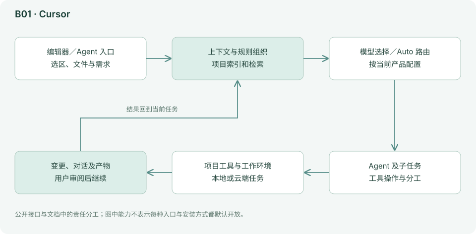

当前产品还扩展了子代理、项目协调和云端工作。应把本地交互式编辑、后台任务和自动化分别评估：它们接触的环境、凭据和可运行时长可能不同。子代理能够减少主对话被探索细节占满的问题，但最终仍要有人检查集成结果。[子代理](https://cursor.com/docs/subagents)

代码索引相当于项目的查找目录：它先帮助找相关材料，再由模型根据本轮任务阅读和行动。索引能减少盲目搜索，但被排除的文件、陈旧内容和隐含业务规则仍可能遗漏。子代理可以承接调查，主代理再整合结果。云端 Agent 则多出独立环境、仓库授权和结果取回过程，所以本地 Agent 跑通并不能证明云端任务也已配置好。

### 能力、状态与边界

| 观察项 | 实际机制／公开能力 | 对使用者意味着什么 |
|---|---|---|
| 即时上下文 | 文件、选区、诊断与项目线索 | 给出具体入口通常比泛泛要求重写项目有效 |
| 项目索引 | 检索相关代码后进入模型上下文 | 用已知答案抽查检索，不把索引视为整仓理解 |
| 交互方式 | 补全、局部编辑与多步 Agent | 按任务尺度选择，减少不必要的长循环 |
| 分工 | 子代理与项目协调等能力 | 独立探索后仍需检查接口和文件冲突 |
| 云端 | 独立任务环境与自动化 | 重新配置依赖、秘密信息与仓库权限 |
| 模型 | Auto／Composer 与可选固定型号 | 比较时记录实际路由、模式和账单规则 |

### 资料依据与继续阅读

[Agent 文档](https://cursor.com/docs/agent/overview)、[子代理](https://cursor.com/docs/subagents)、[模型与计费](https://cursor.com/docs/models)。

完整商业运行时未公开，结构判断以官方可见行为和接口为限。上面的结构与边界依据这些材料整理；当前安装方式、型号和菜单以官方最新文档为准。

## B02 GitHub Copilot：嵌入代码协作平台的一组代理入口

*简档：保留定位、总体结构和能力边界；上手命令、试用任务和模型路线不再随事实刷新维护，选型请参考[第 05 章的场景表](05-按场景选择组合.md)与[第 06 章的集中表](06-模型搭配与成本.md)。*

### 定位与设计理念

Copilot 的补全、IDE Chat／Agent、CLI 和云端编码代理不是同一个执行环境。IDE 代理在开发者附近修改和验证；云端代理围绕 issue、分支、PR 等协作对象工作。选择 Copilot，往往也是选择 GitHub 的协作入口、组织账户和审查流程。[官方功能文档](https://docs.github.com/en/copilot/concepts/agents/cloud-agent/about-cloud-agent)

Copilot 的优势是把 AI 接进已有协作对象：开发者在 IDE 工作，团队通过 issue 表达需求，通过 PR 审阅结果。对于已经使用 GitHub 的组织，账户、代码权限与协作流程的整合往往比另装一套代理更省沟通成本。但它是多个产品入口的集合，必须先选清楚具体是哪一条路线，才能讨论模型、权限和费用。

### 工作原理与架构图

下图依据官方公开接口整理，表示责任分工，不代表已审计闭源内部实现。

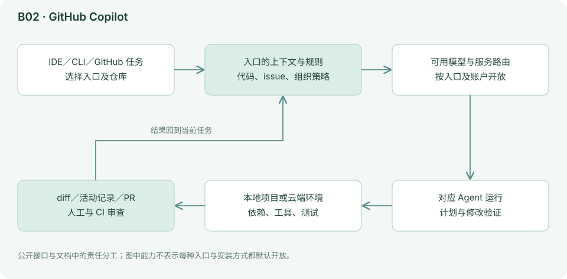

旧 `microsoft/vscode-copilot-chat` 已归档，相关开发迁入 VS Code 主仓库。不能因旧仓库归档就断言 Copilot 停止开发，也不能因 VS Code 开源就声称 GitHub 托管代理的全部服务端已经开源。公开仓库用于核对编辑器侧实现，云端行为以服务文档为准。[旧仓库](https://github.com/microsoft/vscode-copilot-chat)、[VS Code 当前源码](https://github.com/microsoft/vscode)

IDE 代理围绕当前开发环境工作；云端代理则需要从仓库、任务说明和环境配置重新建立上下文。因此，口头说过但没有写进 issue 的背景，远端任务未必知道。PR 提供了清楚的交接点：需求、补丁、CI 与人工评审能放在一起；但 PR 是交付容器，不是质量证明。公开的编辑器侧源码也不能替代云端服务端实现的证据。

### 能力、状态与边界

| 观察项 | 实际机制／公开能力 | 对使用者意味着什么 |
|---|---|---|
| 入口差异 | 补全、IDE Agent、CLI 与云端代理 | 先选入口，再查模型和权限，不按品牌一概而论 |
| 协作载体 | issue、分支与 PR | 验收标准放进任务，结果回到正常审查 |
| 组织治理 | 账户、仓库访问与模型可用性 | 个人能选的模型不一定获组织允许 |
| 执行环境 | IDE 附近的本地环境或云端环境 | 云端需独立准备依赖和所需资料 |
| 源码边界 | 编辑器侧实现与闭源托管部分并存 | 旧仓库迁移不能解读成全产品停止 |
| 完成定义 | 任务产物与后续审查分开 | 创建 PR 后仍需测试、审阅和合并决定 |

### 资料依据与继续阅读

[官方功能文档](https://docs.github.com/en/copilot/concepts/agents/cloud-agent/about-cloud-agent)、[旧仓库](https://github.com/microsoft/vscode-copilot-chat)、[VS Code 当前源码](https://github.com/microsoft/vscode)、[模型支持矩阵](https://docs.github.com/en/copilot/reference/ai-models/supported-models)。

完整商业运行时未公开，结构判断以官方可见行为和接口为限。上面的结构与边界依据这些材料整理；当前安装方式、型号和菜单以官方最新文档为准。

## B03 Devin／Devin Desktop：从编辑器协作延伸到远程交付

*简档：保留定位、总体结构和能力边界；上手命令、试用任务和模型路线不再随事实刷新维护，选型请参考[第 05 章的场景表](05-按场景选择组合.md)与[第 06 章的集中表](06-模型搭配与成本.md)。*

### 定位与设计理念

旧 Windsurf 文档已迁入 Devin Desktop 文档体系，Cascade 仍是需要辨认的本地代理体验；它与 Devin 云端任务不能混为一谈。报告按产品家族合并说明，避免将迁移前后的名字重复计成两个完全独立竞品。[Cascade 文档](https://docs.devin.ai/desktop/cascade/cascade.md)

Devin 产品家族同时覆盖本地开发交互与远程任务。远程路线以任务委托为主要交互方式：用户提供完整的任务说明，服务准备环境并持续执行，再由用户检查产物。能否成功很大程度取决于任务边界和环境准备，不能只把表现归因于一个模型名字。

### 工作原理与架构图

下图依据官方公开接口整理，表示责任分工，不代表已审计闭源内部实现。

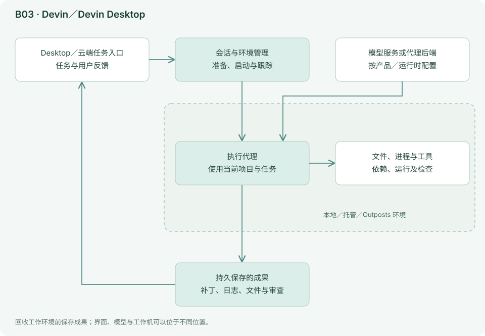

本地 Cascade 围绕编辑器上下文、规划、代码修改和检查点工作；远程 Devin 更强调把仓库、执行环境、任务和协作交付组织起来。需要企业自有基础设施时，还有 Outposts 路线。其架构差别主要在“工作机和任务生命周期由谁管理”，而不只在模型名字。[Devin 入门](https://docs.devin.ai/get-started/first-run.md)、[Outposts](https://docs.devin.ai/cloud/outposts/overview.md)

本地模式可以利用开发者正在使用的环境，远端则要自己拉代码和准备依赖。项目索引或 DeepWiki 帮助代理找背景，却不能补出从未记录的业务决策。Outposts 又把环境控制转向组织管理的基础设施；这提升环境可控性，也把运维责任带回团队。比较时应把入口、运行位置和模型路由三者同时记下来。

### 能力、状态与边界

| 观察项 | 实际机制／公开能力 | 对使用者意味着什么 |
|---|---|---|
| 本地与远端 | Desktop 交互和异步任务 | 即时协作与完整委托适合不同任务 |
| 代码知识 | 项目索引、知识材料及相关服务 | 先用已知问题验证理解，别把文档生成视为事实核验 |
| 环境 | 托管与 Outposts 等路线 | 自管环境需要安装、网络和资源维护 |
| 长任务 | 会话推进与任务产物交接 | 需求、进度和验收必须能独立理解 |
| 模型 | Desktop／CLI 选择与云端路由有差异 | 不推定所有入口都支持任意 BYOK |
| 交付 | 代码、分支、执行结果 | 任务完成后仍进入团队审查与测试 |

### 资料依据与继续阅读

[Cascade 文档](https://docs.devin.ai/desktop/cascade/cascade.md)、[Devin 入门](https://docs.devin.ai/get-started/first-run.md)、[Outposts](https://docs.devin.ai/cloud/outposts/overview.md)、[CLI 模型说明](https://docs.devin.ai/cli/models.md)。

完整商业运行时未公开，结构判断以官方可见行为和接口为限。上面的结构与边界依据这些材料整理；当前安装方式、型号和菜单以官方最新文档为准。

## B04 Kiro：让需求、设计和任务清单成为持续上下文

*简档：保留定位、总体结构和能力边界；上手命令、试用任务和模型路线不再随事实刷新维护，选型请参考[第 05 章的场景表](05-按场景选择组合.md)与[第 06 章的集中表](06-模型搭配与成本.md)。*

### 定位与设计理念

Kiro 的辨识度在于 Spec 工作方式：先把需求、设计与实施任务写成可查看、可修改的材料，再让代理推进。它适合需求需要解释、多人需要对齐、实现时间跨度较长的项目。Spec 的价值在于明确需求、设计与验收共识。[Specs](https://kiro.dev/docs/specs/)

Kiro 将需求、设计和任务列表视为开发过程中持续使用的材料。模型围绕可持续修订的规范推进工作。对业务规则多、需要跨人交接的功能，这可以减少来回解释；对已经完全明确的一行修复，则可能增加不必要的文档成本。规范是否有用，要看它能否帮助澄清分歧、指导实施和检查结果。

### 工作原理与架构图

下图依据官方公开接口整理，表示责任分工，不代表已审计闭源内部实现。

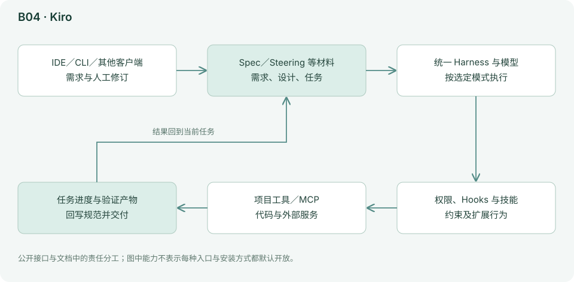

官方说明将其描述为跨 IDE、CLI、Web、移动入口的统一独立进程 Harness，通过 ACP 及相关扩展连接客户端。规则、Hooks、MCP、Skills 等围绕同一个核心配置，但功能在各入口仍有差异。“同一核心”意味着复用执行责任，不意味着所有界面功能完全相等。[工作原理](https://kiro.dev/docs/how-kiro-works/)

需求说明应回答用户要什么，设计说明回答准备用什么结构实现，任务列表回答当前先做哪一小步。三者形成可查看的交接材料，但它们也可能过时：代码改了、业务条件变了，就需要同步修订。统一进程 Harness 和 ACP 解决跨入口复用；Spec 解决工作方法，两者是不同层面的设计，不能把用了同一核心理解成所有客户端功能完全一样。

### 能力、状态与边界

| 观察项 | 实际机制／公开能力 | 对使用者意味着什么 |
|---|---|---|
| 需求材料 | Spec 将需求、设计与任务显式保存 | 用户需删掉空话，补上例外和验收 |
| 长期规则 | Steering 等持续背景 | 区分全项目约定与一次任务进度 |
| 跨入口 | 统一核心与 ACP 等连接方式 | 逐入口确认支持程度和可见功能 |
| 扩展 | Hooks、MCP、Skills 等 | 确定性触发与模型判断的方法要分清 |
| 模型 | Auto 及当前可选型号 | 档位变化后用同一规范测试结果 |
| 维护 | 规范与代码需要共同演进 | 完成后清除过时任务，记录真实设计差异 |

### 资料依据与继续阅读

[Specs](https://kiro.dev/docs/specs/)、[工作原理](https://kiro.dev/docs/how-kiro-works/)、[模型矩阵](https://kiro.dev/docs/models/)。

完整商业运行时未公开，结构判断以官方可见行为和接口为限。上面的结构与边界依据这些材料整理；当前安装方式、型号和菜单以官方最新文档为准。

## B05 JetBrains Junie：让代理使用 IDE 已经理解的代码结构

*简档：保留定位、总体结构和能力边界；上手命令、试用任务和模型路线不再随事实刷新维护，选型请参考[第 05 章的场景表](05-按场景选择组合.md)与[第 06 章的集中表](06-模型搭配与成本.md)。*

### 定位与设计理念

Junie 的差异化在 JetBrains IDE 的代码理解能力：项目、符号、导航、诊断和运行配置已经存在，代理可以借此工作，而不必完全依赖文本搜索。当前产品还包含 CLI、CI 和远程监控等入口，已经不是只能在 IDE 中调用单一模型的小功能。[官方产品页](https://junie.jetbrains.com/)

Junie 利用 JetBrains IDE 已经建立的项目理解：符号、引用、诊断与运行配置能为代理提供比纯文本更有结构的入口。对于依赖 IDE 的大型 Java、Kotlin 或 Python 项目，沿用这些能力可以减少重新建立工作环境的成本。前提是项目本身已经正确加载；错误的 SDK 或构建配置不会因为加了模型就自动消失。

### 工作原理与架构图

下图依据官方公开接口整理，表示责任分工，不代表已审计闭源内部实现。

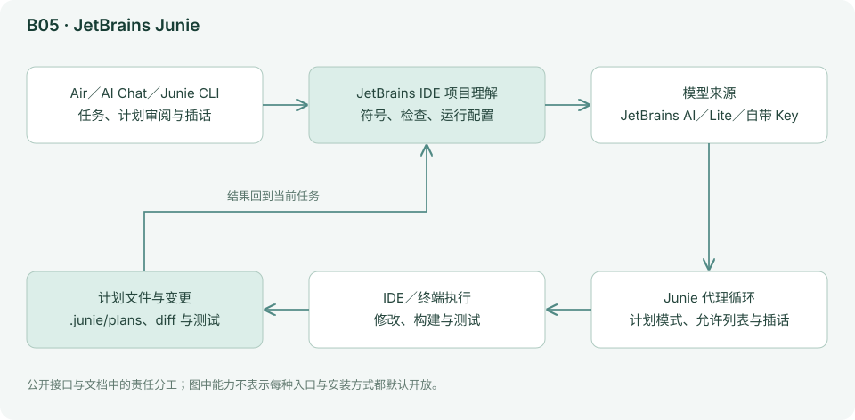

计划阶段可以形成可编辑、可提交的需求／设计／交付材料；实施阶段可用另一档模型。其价值是让“为什么这样改”保存在项目中，同时使用 IDE 的已有工具验证结果。需要注意，宣传中的基准成绩属于厂商材料，本报告没有据此宣布它普遍优于其他代理。

文本搜索擅长找字符串，IDE 的语义能力则可以帮助区分同名符号、调用与类型关系。代理因此有机会做更精确的定位，但是否正确仍要看实际操作与补丁。规划和实施可以使用不同模型，是把成本投入与职责分开的一种方法；如果规划中的接口约定没有进入实施上下文，再强的规划模型也无法保证最终一致。

### 能力、状态与边界

| 观察项 | 实际机制／公开能力 | 对使用者意味着什么 |
|---|---|---|
| 项目理解 | IDE 的导航、符号、诊断与运行配置 | 先确认项目索引与构建正确 |
| 规划材料 | 可编辑、可保留的设计与交付说明 | 计划需要具体到接口和兼容要求 |
| 实施 | 在既有开发环境修改并验证 | 代理用的运行配置应与人工一致 |
| 入口 | IDE 之外还有 CLI／CI 等路线 | 逐个入口确认可用的代码理解能力 |
| 模型 | 当前产品提供 BYOK／本地等配置路线 | 部署路线和具体型号仍需账户与版本核对 |
| 成本 | 规划和实施可分配不同能力 | 以整项任务及返工衡量，不能只看实施模型便宜 |

### 资料依据与继续阅读

[官方产品页](https://junie.jetbrains.com/)。

完整商业运行时未公开，结构判断以官方可见行为和接口为限。上面的结构与边界依据这些材料整理；当前安装方式、型号和菜单以官方最新文档为准。

## B06 Zed：编辑器可以是代理的宿主，不必包办代理的全部能力

*简档：保留定位、总体结构和能力边界；上手命令、试用任务和模型路线不再随事实刷新维护，选型请参考[第 05 章的场景表](05-按场景选择组合.md)与[第 06 章的集中表](06-模型搭配与成本.md)。*

### 定位与设计理念

Zed 是开放的高性能编辑器，同时提供自有 Agent 和 ACP 外部代理接入。它最有启发性的设计是将编辑器与代理运行时分开：用户可以喜欢 Zed 的交互，却选择 Codex、Claude、OpenCode、Pi 等代理执行任务。[项目](https://github.com/zed-industries/zed/blob/16c9aa7ea6d897a8044d9501cde1b295256722f2/README.md)、[AI 概览](https://zed.dev/docs/ai/overview)

Zed 把编辑器与代理明确分开。用户可以保留一个轻快的编辑器，选择内置 Agent，也可以把任务交给外部完整代理。这样，喜欢某个界面与喜欢某种执行方式不必成为同一个决定。开放协议降低了入口替换成本，但不会统一所有后端的模型、工具权限和收费方式。

### 工作原理与架构图

下图结合所引源码与文档，画出本工具的主要责任分工；为便于理解，省略次要模块与错误分支。

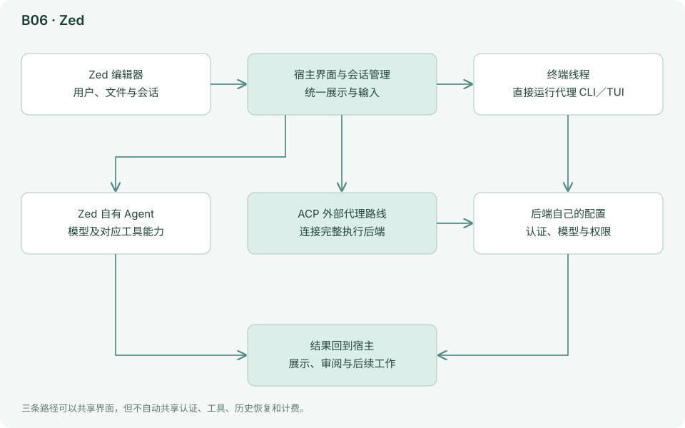

外部代理通常拥有自己的认证、模型选择、工具和配置；Zed 展示会话和交互。给 Zed 自有模型入口填了 API Key，并不自动意味着外部 Codex 或 Claude 也完成了相应认证。它们的费用、数据处理和权限仍要看各自运行时。[外部代理文档](https://github.com/zed-industries/zed/blob/16c9aa7ea6d897a8044d9501cde1b295256722f2/docs/src/ai/external-agents.md)

选择内置 Agent 时，Zed 负责组织较多代理行为；选择 ACP 时，Zed 更像客户端，把会话输入、权限交互和更新连到外部进程。这个差别会影响排错：外部模型认证失败，要检查外部代理配置；编辑器显示异常，则可能是连接或展示问题。统一面板能够减少学习入口的成本，却不能保证不同代理的历史、命令和能力一一对应。

### 能力、状态与边界

| 观察项 | 实际机制／公开能力 | 对使用者意味着什么 |
|---|---|---|
| 两条路线 | 内置 Agent 与 ACP 外部代理 | 试用时明确当前谁负责执行循环 |
| 上下文 | 编辑器项目线索与代理自身规则 | 检查文件选择怎样进入外部会话 |
| 认证 | 内置模型与外部代理可分开管理 | 给 Zed 配 Key 不自动登录外部代理 |
| 权限 | 客户端呈现交互，后端有自身执行边界 | 确认远端／本机执行位置和实际授权 |
| 模型选择 | 取决于所选运行时 | 组合应写成 Zed＋代理＋模型 |
| 迁移 | 统一入口有助于比较后端 | 历史恢复与特殊命令仍须逐个验证 |

### 资料依据与继续阅读

[项目](https://github.com/zed-industries/zed/blob/16c9aa7ea6d897a8044d9501cde1b295256722f2/README.md)、[AI 概览](https://zed.dev/docs/ai/overview)、[外部代理文档](https://github.com/zed-industries/zed/blob/16c9aa7ea6d897a8044d9501cde1b295256722f2/docs/src/ai/external-agents.md)。

源码链接指向固定提交；关键实现分析不等于对整个项目和依赖逐行审计。上面的结构与边界依据这些材料整理；当前安装方式、型号和菜单以官方最新文档为准。

## B07 TRAE／SOLO：从编程界面走向可交付的完整工作

*简档：保留定位、总体结构和能力边界；上手命令、试用任务和模型路线不再随事实刷新维护，选型请参考[第 05 章的场景表](05-按场景选择组合.md)与[第 06 章的集中表](06-模型搭配与成本.md)。*

### 定位与设计理念

TRAE 产品、SOLO 工作方式，以及 GitHub 上的 `trae-agent` 研究代码不能互相替代。后者维护状态并不能证明商业产品当前活跃程度。本报告将 TRAE／SOLO 作为商业产品家族，研究仓库另列观察项。

TRAE／SOLO 强调从需求走到成品。编程之外，资料、数据和报告也可以作为任务对象，用户无需每一步都手动把聊天内容复制成文件。对于不想配置大量工具的人，这种工作台有吸引力；但托管产品的内部路由和运行时不完全公开，因此应通过具体成果检验，而不根据角色名推断内部架构。

### 工作原理与架构图

下图依据官方公开接口整理，表示责任分工，不代表已审计闭源内部实现。

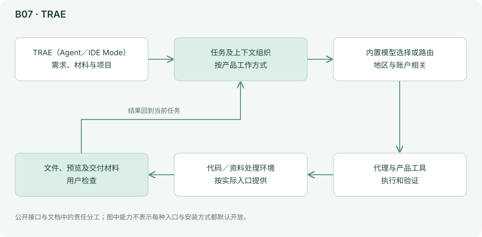

官方已将 SOLO 扩展到独立桌面和 Web 体验，并区分偏编程的工作与 More Than Coding 的资料、报告、数据任务。其方向是减少“模型回答完，用户再手工整理成品”的断层。但闭源运行时的调度、压缩和内部模型路由无法从公开网页完整还原。[官方产品页](https://www.trae.ai/)、[SOLO 说明](https://www.trae.ai/blog/new_solo_beta_0331)

从用户可见流程看，输入不仅是一句提问，还包括项目、附件和输出格式；代理将工作分阶段推进，并把结果放回可查看的产物。这个结构适合“先收材料、再分析、再制作”的任务。需要分别检查各阶段：读到资料不等于事实正确，生成文件不等于排版可用，原型跑起来也不等于后端、权限和部署已经完成。

### 能力、状态与边界

| 观察项 | 实际机制／公开能力 | 对使用者意味着什么 |
|---|---|---|
| 产品身份 | 商业 TRAE／SOLO 与研究 trae-agent 分开 | 研究仓库状态不能代表商业产品维护 |
| 任务范围 | 编程及部分资料、报告、数据工作 | 按具体入口确认可交付文件与工具 |
| 地区差异 | 国内／国际及不同版本 | 模型目录、额度和服务可用性分别核验 |
| 成品流程 | 任务执行与产物呈现结合 | 需检查中间依据和最终文件，不只看摘要 |
| 模型 | 产品可选型号或内置路由 | 不假定每个版本都有自由 BYOK |
| 透明程度 | 商业内部实现未完整公开 | 以公开接口和实用验收为证据边界 |

### 资料依据与继续阅读

[官方产品页](https://www.trae.ai/)、[SOLO 说明](https://www.trae.ai/blog/new_solo_beta_0331)。

完整商业运行时未公开，结构判断以官方可见行为和接口为限。上面的结构与边界依据这些材料整理；当前安装方式、型号和菜单以官方最新文档为准。

## B08 Augment／Auggie：先解决“找对代码和业务背景”

*简档：保留定位、总体结构和能力边界；上手命令、试用任务和模型路线不再随事实刷新维护，选型请参考[第 05 章的场景表](05-按场景选择组合.md)与[第 06 章的集中表](06-模型搭配与成本.md)。*

### 定位与设计理念

对大型代码库来说，模型不一定缺少编程知识，更常缺少“这家公司把事情放在哪里、为什么这样做”。Augment 的 Context Engine 围绕项目和相关仓库提供检索与上下文。Auggie 则把这种能力带入 CLI。[Agent 文档](https://docs.augmentcode.com/jetbrains/using-augment/agent.md)、[Auggie 入门](https://docs.augmentcode.com/cli/overview.md)

Augment 的重点是让代理先拿到正确背景。大型仓库里的一个常见难点，是找到已有实现、隐含约定和跨仓库依赖。Context Engine 把查找材料放到模型之前，Auggie 再据此执行任务。这条路线在知识分散的成熟项目中更容易体现价值。

### 工作原理与架构图

下图依据官方公开接口整理，表示责任分工，不代表已审计闭源内部实现。

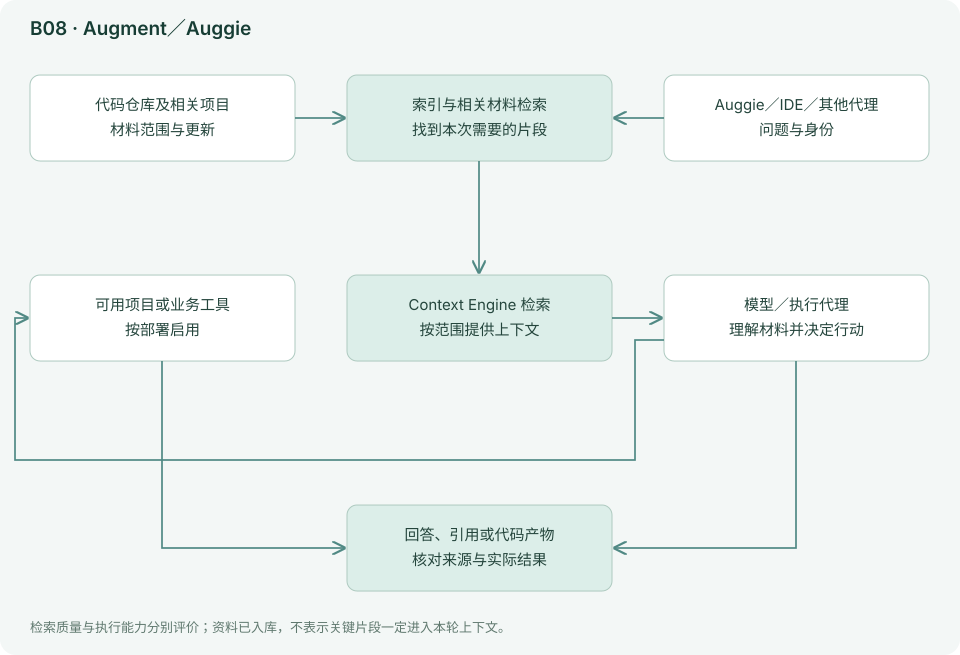

索引和检索层位于模型之前，负责找材料；代理再决定怎样行动。索引需要维护，文件排除范围、更新延迟和访问权限会影响结果。它不保证一个名字相似的检索结果就是正确依赖。Context Engine 也能作为 MCP 服务给其他代理使用，这意味着团队可以只替换“找资料”这一层。[Context Engine MCP](https://docs.augmentcode.com/context-services/mcp/overview.md)

索引相当于预先制作一份能检索的项目地图，查询时再挑选与任务有关的片段。这可以减少手工找文件，却会受覆盖范围、更新时机和权限影响。Context Engine 通过 MCP 提供给其他代理时，只替换了“找材料”这一层，后面的执行核心和模型仍由原工具负责。这样可以复用知识基础设施，但也要分别评价检索质量与代理实施能力。

### 能力、状态与边界

| 观察项 | 实际机制／公开能力 | 对使用者意味着什么 |
|---|---|---|
| 上下文服务 | Context Engine 的代码索引与检索 | 用真实业务问题检验检索内容是否完整、相关 |
| 仓库范围 | 按配置覆盖项目与相关材料 | 纳入正确依赖，比无差别扩大范围更重要 |
| 时效 | 索引与代码更新需要衔接 | 变更后抽查是否仍返回旧实现 |
| 权限 | 上下文材料的可见范围 | 组织资料进入检索前要有明确访问控制 |
| 独立接入 | Context Engine MCP 可服务其他代理 | 组合应区分检索层、执行层与模型层 |
| 成本 | 索引维护与实际任务调用 | 检索省时需与维护及服务成本一起评估 |

### 资料依据与继续阅读

[Agent 文档](https://docs.augmentcode.com/jetbrains/using-augment/agent.md)、[Auggie 入门](https://docs.augmentcode.com/cli/overview.md)、[Context Engine MCP](https://docs.augmentcode.com/context-services/mcp/overview.md)。

完整商业运行时未公开，结构判断以官方可见行为和接口为限。上面的结构与边界依据这些材料整理；当前安装方式、型号和菜单以官方最新文档为准。

## B09 Amp：把能力档位定义为一整套执行配置

*简档：保留定位、总体结构和能力边界；上手命令、试用任务和模型路线不再随事实刷新维护，选型请参考[第 05 章的场景表](05-按场景选择组合.md)与[第 06 章的集中表](06-模型搭配与成本.md)。*

### 定位与设计理念

Amp 当前的 low／medium／high／ultra 不只是更换模型。每档组合了模型、推理强度、系统提示、工具和 Oracle 等能力。它体现了一种产品判断：用户选“这个任务值得投入多少能力”，具体执行组合由产品组织。[模式与模型](https://ampcode.com/docs/markdown/models-and-subagents)

Amp 将任务投入做成可选择的能力档位，减少用户逐项配置模型参数的负担。档位可能同时改变模型、推理强度、工具和专家调用。这样能降低调参负担，但也意味着两次不同档位的比较，不是严格的单模型实验。产品替用户做了一部分编排决策，用户仍要判断这些额外能力是否值得。

### 工作原理与架构图

下图依据官方公开接口整理，表示责任分工，不代表已审计闭源内部实现。

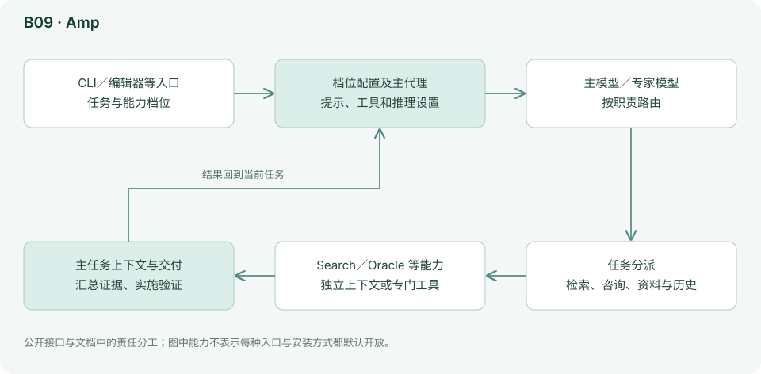

Search、Oracle、Librarian、Read Thread 等专门处理代码检索、难题推理、外部资料和历史任务。它们通常拥有独立上下文，主代理收到汇总；文档明确区分这种分工与可彼此随意沟通的团队。Orbs 则扩展到持久远程工作环境。[工具](https://ampcode.com/docs/markdown/tools)、[Orbs 入门](https://ampcode.com/docs/markdown/orbs/getting-started)

主代理遇到难题时可以咨询 Oracle，调查外部材料时使用 Librarian，检索代码则有其他专门能力。这些职责通常交回结论，帮助主对话避免被大量中间过程占满。它们不是必然彼此通信的一个团队。升档增加的能力可能减少返工，也可能对简单任务产生额外调用，因此可以结合总耗时、调用量和人工纠正次数评估升档收益。

### 能力、状态与边界

| 观察项 | 实际机制／公开能力 | 对使用者意味着什么 |
|---|---|---|
| 能力档位 | low／medium／high／ultra 等组合配置 | 档位不只是模型名或单一推理参数 |
| 专家分工 | Search、Oracle、Librarian 等 | 核对角色实际职责，不按名称幻想权限 |
| 上下文 | 专门任务与主任务之间进行汇总 | 交接需要证据和文件位置，不能只有结论 |
| 历史 | Read Thread 等历史访问能力 | 历史可访问不代表每轮自动全部读入 |
| 远程环境 | Orbs 等持久工作路线 | 另检查环境、凭据与生命周期 |
| 可复现性 | 官方路由可能随产品更新 | 记录档位、实际模型、工具配置和版本 |

### 资料依据与继续阅读

[模式与模型](https://ampcode.com/docs/markdown/models-and-subagents)、[工具](https://ampcode.com/docs/markdown/tools)、[Orbs 入门](https://ampcode.com/docs/markdown/orbs/getting-started)。

完整商业运行时未公开，结构判断以官方可见行为和接口为限。上面的结构与边界依据这些材料整理；当前安装方式、型号和菜单以官方最新文档为准。

## B10 Factory Droid：把大任务组织成可验证的交付过程

*简档：保留定位、总体结构和能力边界；上手命令、试用任务和模型路线不再随事实刷新维护，选型请参考[第 05 章的场景表](05-按场景选择组合.md)与[第 06 章的集中表](06-模型搭配与成本.md)。*

### 定位与设计理念

Droid 提供通用代理执行，Missions 进一步安排规划、工作者和验证。与简单地“同时开五个聊天窗口”相比，其重点是任务交接、状态和完成标准。[Missions](https://docs.factory.ai/missions/overview.md)

Factory Droid 把大任务看成一组需要交接和验证的工作。Missions 的价值不在于能开多少代理，而在于规划者、工作者与验证之间有可查看的材料和完成条件。只有接口明确、各部分能检验时，拆分才可能提高吞吐；需求模糊时增加工作者，往往只是更快地产生彼此不一致的代码。

### 工作原理与架构图

下图依据官方公开接口整理，表示责任分工，不代表已审计闭源内部实现。

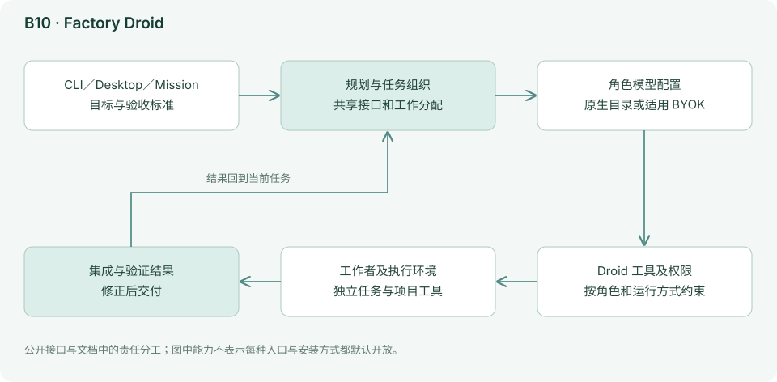

自定义 Droid 用项目级或用户级 Markdown 配置，指定职责、模型和工具；被调用时拥有独立上下文。官方还明确描述了工作者的限制，例如特定非交互式子任务不能像主代理那样随意向用户提问或继续套娃调用。限制能减少失控，也意味着主任务必须给出足够明确的输入。[子代理](https://docs.factory.ai/harness/subagents.md)

BYOK 也有入口范围：当前说明针对 CLI／Desktop 配置，不应扩展为所有托管 Web、移动入口自动支持相同自定义模型。权限和沙箱同样要分别配置。[BYOK](https://docs.factory.ai/model-independence/byok.md)、[沙箱](https://docs.factory.ai/autonomy-and-safety/sandbox.md)

自定义 Droid 文件为一类任务定义职责、模型和工具，被调用后拥有自己的上下文。这让主任务可以把大量实现细节交出去，但也失去对子任务隐含假设的直接掌握。非交互工作者无法随时追问用户，因此规划阶段要把必要信息给足。验证者应依据代码与运行结果判断，不能只是重新读取工作者的成功总结。

### 能力、状态与边界

| 观察项 | 实际机制／公开能力 | 对使用者意味着什么 |
|---|---|---|
| 任务层次 | 普通 Droid 与 Missions | 小任务不一定需要完整编排 |
| 角色配置 | Markdown 定义职责、模型和工具 | 角色描述要能转化为明确的交付件 |
| 上下文 | 子代理拥有独立任务上下文 | 接口与共享事实需要显式传递 |
| 工作者限制 | 某些非交互路径限制提问和继续派生 | 不确定信息应在任务下发前解决 |
| 模型独立 | CLI／Desktop 等入口有 BYOK 路线 | 不把该能力扩展到所有托管入口 |
| 完成控制 | 计划、实施和验证组成交付过程 | 证据需独立可查，避免代理自评替代验收 |

### 资料依据与继续阅读

[Missions](https://docs.factory.ai/missions/overview.md)、[子代理](https://docs.factory.ai/harness/subagents.md)、[BYOK](https://docs.factory.ai/model-independence/byok.md)、[模型目录](https://docs.factory.com/models)。

完整商业运行时未公开，结构判断以官方可见行为和接口为限。上面的结构与边界依据这些材料整理；当前安装方式、型号和菜单以官方最新文档为准。

## B11 Warp／Automation Platform：从终端会话走向可触发的代理任务

*简档：保留定位、总体结构和能力边界；上手命令、试用任务和模型路线不再随事实刷新维护，选型请参考[第 05 章的场景表](05-按场景选择组合.md)与[第 06 章的集中表](06-模型搭配与成本.md)。*

### 定位与设计理念

Warp 原生终端会把命令、输出与上下文组织得更结构化。其代理在这样的工作环境中使用工具；同时也支持把 Claude Code、Codex、OpenCode 等第三方 CLI 放进 Warp。后者使用的代理核心仍属于第三方，而不是一律变成 Warp Agent。[Agents 文档](https://docs.warp.dev/_llms-txt/agents.txt)

Warp 从终端出发，把命令及其输出组织成容易理解的工作单元；原生 Agent 在此基础上完成多步操作，Automation Platform 再把稳定工作转成可触发任务。这条路线适合本来就在终端处理构建、日志和环境的人。需要先分清自己是在 Warp 里运行第三方 CLI，还是使用 Warp 自己的代理，因为两者的模型和执行逻辑不同。

### 工作原理与架构图

下图依据官方公开接口整理，表示责任分工，不代表已审计闭源内部实现。

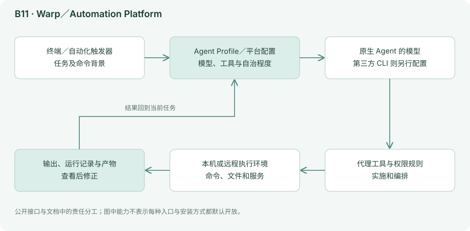

Agent Profiles 配置模型、自治程度、工具与命令权限；Automation Platform 再提供远程环境、触发器、编排和观察能力。部分接口与应用仍使用 Oz 名称。比较时应区分“Warp 作为终端”“Warp 原生 Agent”和“平台上的远程执行”。[CLI 文档](https://docs.warp.dev/_llms-txt/warp-agent-cli.txt)

终端保留命令与输出，有助于模型把错误和具体操作对应起来。Profile 将模型、工具和自治程度保存为一组配置，让重复任务少一些临时设置；触发器只负责何时开始，远程环境负责在哪里执行。一个本机排障任务变成定时自动化时，输入、凭据、重复执行和失败通知都需要重新设计，不能只给同一句提示加一个时间表。

### 能力、状态与边界

| 观察项 | 实际机制／公开能力 | 对使用者意味着什么 |
|---|---|---|
| 终端宿主 | 可运行第三方编码 CLI | 第三方核心与账单仍按其自身规则 |
| 原生 Agent | 结合终端上下文与工具执行 | 核对读取到的命令输出与实际运行环境 |
| Profiles | 模型、工具、自治与命令权限 | 配置保存后仍需按任务限制能力 |
| 自动化平台 | 触发、远程环境、编排与观察 | 启动成功不代表业务任务完成 |
| 生命周期 | 本机会话与远程任务分开 | 退出终端后是否继续取决于运行路线 |
| 权限 | 执行凭据与命令权限共同限制影响 | 产品界面的确认不能替代系统账户边界 |

### 资料依据与继续阅读

[Agents 文档](https://docs.warp.dev/_llms-txt/agents.txt)、[CLI 文档](https://docs.warp.dev/_llms-txt/warp-agent-cli.txt)。

完整商业运行时未公开，结构判断以官方可见行为和接口为限。上面的结构与边界依据这些材料整理；当前安装方式、型号和菜单以官方最新文档为准。

## B12 Google Antigravity：让代码、浏览器和任务产物一起进入代理流程

*简档：保留定位、总体结构和能力边界；上手命令、试用任务和模型路线不再随事实刷新维护，选型请参考[第 05 章的场景表](05-按场景选择组合.md)与[第 06 章的集中表](06-模型搭配与成本.md)。*

### 定位与设计理念

Antigravity 把多步开发与可查看的产物结合，代理不仅输出代码，也通过计划、说明和浏览器结果帮助用户判断任务是否完成。其价值在于让开发验证进入同一工作过程。[Agent 文档](https://www.antigravity.google/docs/agent)

Antigravity 将代码、浏览器操作和可查看的任务产物放进同一开发流程。对 Web 开发而言，模型需要的不只是编辑文件，还要观察页面实际如何运行。计划和验证材料帮助用户检查过程，但任何可视化产物都只是证据的一种：截图可以证明某个瞬间的外观，不能证明所有交互和异常路径正确。

### 工作原理与架构图

下图依据官方公开接口整理，表示责任分工，不代表已审计闭源内部实现。

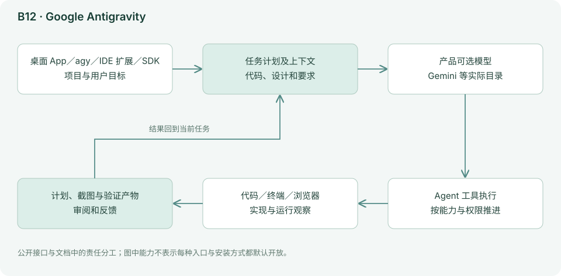

对浏览器的操作、终端命令、项目修改和并行会话应分别看权限与环境。产物展示能提高可审查性，但截图好看不等于功能、无障碍和异常状态都正确。

浏览器反馈把“我写了样式”变成“我看到了渲染结果”，有助于发现布局、资源和交互问题。代理仍需决定访问哪条路径、输入什么数据、如何判断成功；如果测试步骤只打开首页，报告就无法支持登录和权限已正确的结论。并行任务也应约定组件与接口边界，避免不同代理同时改全局样式或共享配置。

### 能力、状态与边界

| 观察项 | 实际机制／公开能力 | 对使用者意味着什么 |
|---|---|---|
| 工作对象 | 代码、浏览器与任务产物 | 把功能路径纳入验收，不只看生成代码 |
| 计划 | 可查看的任务组织材料 | 用户应确认范围、假设和验证步骤 |
| 视觉验证 | 浏览器操作与截图等产物 | 截图只支持被实际观察到的状态 |
| 执行权限 | 文件、终端和浏览器各有能力范围 | 分别检查账户、目录和网页操作权限 |
| 模型 | 以当前官方模型目录为准 | 不能把别处发布的型号推定为这里可选 |
| 交付 | 代码修改与运行材料一起审查 | 还要覆盖无障碍、错误、空数据与响应式 |

### 资料依据与继续阅读

[Agent 文档](https://www.antigravity.google/docs/agent)、[模型列表](https://www.antigravity.google/docs/models/)。

完整商业运行时未公开，结构判断以官方可见行为和接口为限。上面的结构与边界依据这些材料整理；当前安装方式、型号和菜单以官方最新文档为准。

## B13 Replit Agent：把从想法到可运行应用的环境准备一起包起来

*简档：保留定位、总体结构和能力边界；上手命令、试用任务和模型路线不再随事实刷新维护，选型请参考[第 05 章的场景表](05-按场景选择组合.md)与[第 06 章的集中表](06-模型搭配与成本.md)。*

### 定位与设计理念

Replit Agent 面向“我想做一个东西”的用户，把项目生成、运行环境、预览和发布串在一起。对初学者而言，省去安装依赖和配置服务往往比多一个模型选项更重要。[Agent 介绍](https://docs.replit.com/features/agent/overview.md)

Replit Agent 把搭环境这件事也包含在产品里。初学者不必先理解本地依赖、预览服务器和部署步骤，就能从需求开始做应用。这降低了从想法到可运行原型的门槛；当原型成为真实业务时，数据、认证、运行费用和迁移才会变成主要问题。起步简单与长期维护简单是两个阶段的判断。

### 工作原理与架构图

下图依据官方公开接口整理，表示责任分工，不代表已审计闭源内部实现。

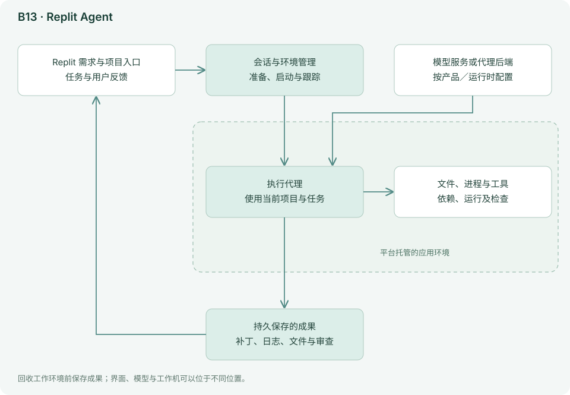

这是托管开发环境中的代理。平台控制环境与部分路由，因此起步快；迁出时需要确认代码、数据库、秘密配置、运行方式和部署依赖分别如何处理。一个可以下载的源码目录，不一定等于完整可迁移的线上系统。

平台同时管理代理和应用环境，所以生成代码后能较快进入预览。真正发布时，还会涉及持续运行、数据库与秘密配置；这些不是一次模型调用费用。迁移也因此应按组件检查：下载源码只带走代码，数据库内容、环境变量和部署设置可能需要另外导出与重建。能力档位由产品组合路由，不能把一个档位永久等同于某个型号。

### 能力、状态与边界

| 观察项 | 实际机制／公开能力 | 对使用者意味着什么 |
|---|---|---|
| 起步 | 需求、代码和环境在同一平台 | 适合先验证核心流程，减少本地搭建成本 |
| 预览 | 生成后运行并交互检查 | 预览可用不等于生产部署已准备完成 |
| 模型选择 | Lite／Economy／Power 等能力路线 | 按任务与预算选档，不臆造固定模型映射 |
| 数据与认证 | 随应用引入相关服务 | 先设计真实数据和账户边界 |
| 费用 | Agent 使用及应用持续运行等项目 | 分别记录开发成本和上线后的月成本 |
| 迁移 | 源码、数据库、配置与部署分别处理 | 演练重建，确认离开平台还能运行 |

### 资料依据与继续阅读

[Agent 介绍](https://docs.replit.com/features/agent/overview.md)、[使用与费用](https://docs.replit.com/learn/build-with-agent.md)、[预算管理](https://docs.replit.com/billing/managing-spend.md)。

完整商业运行时未公开，结构判断以官方可见行为和接口为限。上面的结构与边界依据这些材料整理；当前安装方式、型号和菜单以官方最新文档为准。

## B14 Qoder：把项目知识和目标式执行放在同一个产品里

*简档：保留定位、总体结构和能力边界；上手命令、试用任务和模型路线不再随事实刷新维护，选型请参考[第 05 章的场景表](05-按场景选择组合.md)与[第 06 章的集中表](06-模型搭配与成本.md)。*

### 定位与设计理念

Qoder 同时强调代码理解、项目知识材料与较完整任务的推进。Quest 等工作方式希望把“告诉它目标”转成持续执行；Repo Wiki 则试图让项目背景成为可复用材料。[产品概览](https://docs.qoder.com/qoder/overview.md)、[Quest](https://docs.qoder.com/user-guide/quest/overview.md)

Qoder 将项目知识与目标式执行放在一起：先帮助理解已有仓库，再推进较完整的开发任务。Repo Wiki 是一种可复用的项目说明，Quest 等方式则强调围绕目标持续工作。这个组合适合刚进入陌生项目的人。自动生成的知识材料可作为阅读线索，关键结论再回到当前代码核对。

### 工作原理与架构图

下图依据官方公开接口整理，表示责任分工，不代表已审计闭源内部实现。

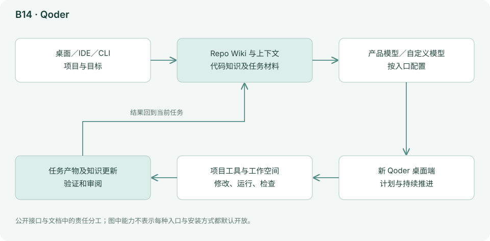

当前桌面、IDE、CLI 等入口的历史和配置不应默认完全互通；文档对导入与独立空间有具体说明。自定义模型也不代表所有辅助能力都使用自己的 Key，例如 Repo Wiki 使用固定模型并单独消耗平台额度。[自定义模型](https://docs.qoder.com/qoder/custom-models.md)

项目知识可以减少每次从零探索的成本，但代码持续变化后，说明也需要更新。任务运行时仍要回到真实文件确认关键行为。自定义模型与平台辅助能力又是两条费用路径：即使主要对话使用自己的 Key，Repo Wiki 等功能仍可能调用产品固定模型并消耗平台额度。因此需要按能力拆账，而非简单分成 BYOK 或订阅两类。

### 能力、状态与边界

| 观察项 | 实际机制／公开能力 | 对使用者意味着什么 |
|---|---|---|
| 知识材料 | Repo Wiki 等项目说明 | 先核对关键入口和数据流，保留原始代码依据 |
| 目标执行 | Quest 等持续任务工作方式 | 完成标准需具体到结果和测试 |
| 多入口 | 桌面、IDE、CLI 各有配置范围 | 导入不等于历史与所有配置自动互通 |
| 模型 | 产品目录与部分自定义 Provider | 按当前入口验证实际模型 ID |
| 辅助费用 | 部分知识能力固定使用平台模型 | 自有 Key 不会覆盖所有平台消费 |
| 迁移 | 代码、知识、规则与会话分开 | 保存关键需求和检查点后再切模型或入口 |

### 资料依据与继续阅读

[产品概览](https://docs.qoder.com/qoder/overview.md)、[Quest](https://docs.qoder.com/user-guide/quest/overview.md)、[自定义模型](https://docs.qoder.com/qoder/custom-models.md)、[模型配置](https://docs.qoder.com/cli/model.md)。

完整商业运行时未公开，结构判断以官方可见行为和接口为限。上面的结构与边界依据这些材料整理；当前安装方式、型号和菜单以官方最新文档为准。

## B15 腾讯 CodeBuddy：面向中文开发生态的多入口代理

*简档：保留定位、总体结构和能力边界；上手命令、试用任务和模型路线不再随事实刷新维护，选型请参考[第 05 章的场景表](05-按场景选择组合.md)与[第 06 章的集中表](06-模型搭配与成本.md)。*

### 定位与设计理念

CodeBuddy 覆盖 IDE、插件和 CLI；其上下文入口包括文件、代码片段、文档、Git 与终端。对微信小程序、腾讯云相关开发者，现成资料入口和中文工作流有实用价值，但这不等于其他项目不能用。[上下文文档](https://www.codebuddy.ai/docs/ide/User-guide/Context)

CodeBuddy 把代理能力放进多种开发入口，同时面向中文和腾讯相关开发生态。对于已有小程序、云服务与团队工具链的用户，现成上下文入口可能比自己拼装连接器更方便。它的价值应在真实项目中衡量；国内、国际、IDE 和 CLI 各自提供什么，不能只凭共同品牌推断。

### 工作原理与架构图

下图依据官方公开接口整理，表示责任分工，不代表已审计闭源内部实现。

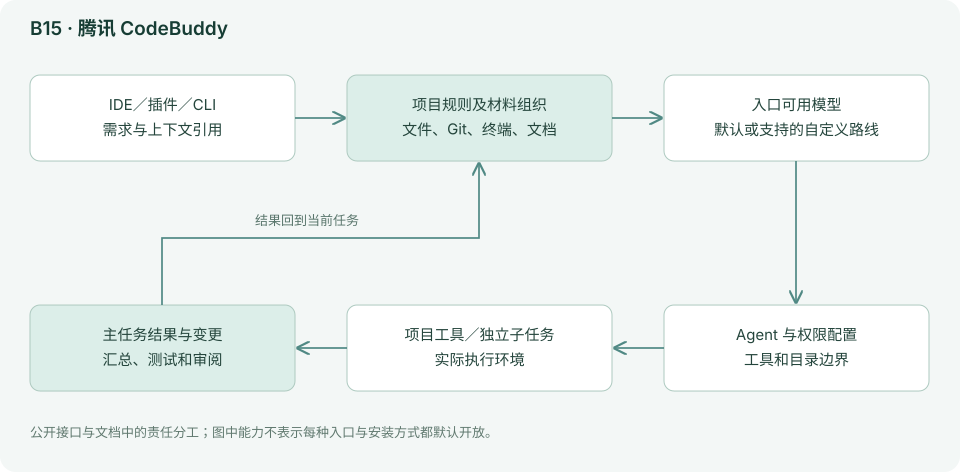

CLI 的自定义子代理可以配置职责、工具和独立上下文，结果返回主代理；项目级与用户级配置承担不同作用。官方还提供团队、工作树、沙箱与 SDK 等文档入口。由于完整商业运行时未公开，本报告只确认文档所述行为，不推断它内部一定复用了某个竞品的实现。[子代理](https://www.codebuddy.cn/docs/cli/sub-agents)、[设置](https://www.codebuddy.cn/docs/cli/settings)

精确引用报错、Git 变更和文件，可以帮助代理从正确位置开始；如果上下文没有指向真正模块，中文对话再顺畅也可能改错。CLI 自定义子代理把一类职责独立保存，主代理调用后获得汇总。工具和权限可能存在继承关系，因此“新建一个研究角色”并不天然意味着只读，要核对最终工具集。

### 能力、状态与边界

| 观察项 | 实际机制／公开能力 | 对使用者意味着什么 |
|---|---|---|
| 产品入口 | IDE、插件和 CLI | 功能与模型按版本和地区分别核对 |
| 上下文 | 文件、代码片段、文档、Git 与终端 | 优先提供与问题直接相关的材料 |
| 子代理 | 独立职责、上下文与工具配置 | 检查继承后的有效权限 |
| 扩展路线 | 团队、工作树、沙箱与 SDK 文档 | 可用性以对应入口说明为准 |
| 生态 | 中文及腾讯相关开发场景 | 生态熟悉度不能替代项目实际验证 |
| 商业边界 | 完整运行时未公开 | 不推断内部一定使用某款竞品核心 |

### 资料依据与继续阅读

[上下文文档](https://www.codebuddy.ai/docs/ide/User-guide/Context)、[子代理](https://www.codebuddy.cn/docs/cli/sub-agents)、[设置](https://www.codebuddy.cn/docs/cli/settings)。

完整商业运行时未公开，结构判断以官方可见行为和接口为限。上面的结构与边界依据这些材料整理；当前安装方式、型号和菜单以官方最新文档为准。

## B16 ZCode：把 GLM 的长任务能力放进目标管理流程

*简档：保留定位、总体结构和能力边界；上手命令、试用任务和模型路线不再随事实刷新维护，选型请参考[第 05 章的场景表](05-按场景选择组合.md)与[第 06 章的集中表](06-模型搭配与成本.md)。*

### 定位与设计理念

ZCode 官方明确围绕 GLM-5.3 适配，重点包括复杂项目理解、长任务、连续代码修改和恢复。Goal Mode 将目标、完成检查和状态恢复放在一个流程里，方向类似“任务尚未完成，就保留继续工作的依据”。[Agent 文档](https://zcode.z.ai/en/docs/agents)

ZCode 将长任务与目标管理结合，希望代理不仅处理当前一句话，还能保留继续工作的依据。对跨多次会话的改造，这比单纯增加窗口长度更有意义。但目标保存只解决“回来时知道要做什么”，完成判断仍需要测试、文件和需求证据，不能由一句自我报告决定。

### 工作原理与架构图

下图依据官方公开接口整理，表示责任分工，不代表已审计闭源内部实现。

文件引用、工作空间、Git 分支、执行模式和推理档位共同决定代理的工作上下文。持久目标不等于模型拥有无限记忆，仍依赖任务状态被正确保存和重新装载。官方还特别说明 `CLAUDE.md` 在迁移时可作为一次性来源，后续使用 `AGENTS.md`；不能看到熟悉的文件名就假定运行时一直自动读取它。

持续目标可以在一轮结束后帮助决定是否继续，也能在暂停后装载当前进度。真正关键的是恢复材料包含哪些事实：已经改过的文件、验证结果、仍未解决的问题和下一步。若只是重复初始需求，模型仍可能重做工作。项目指令迁移同样需要明确：将旧 CLAUDE.md 导入一次，与每次运行持续读取该文件，是不同机制。

### 能力、状态与边界

| 观察项 | 实际机制／公开能力 | 对使用者意味着什么 |
|---|---|---|
| 原生适配 | 围绕 GLM-5.3 的官方路线 | 产品适配主张与跨产品胜负分开理解 |
| 目标管理 | Goal Mode、状态及恢复 | 完成标准需外部可查，不能只凭目标状态 |
| 项目上下文 | 工作空间、文件引用与指令 | 让关键约束进入实际读取的文件 |
| 迁移规则 | 旧指令可作迁移来源，后续使用 AGENTS.md | 修改规则后核对当前任务读取的文件与生效状态 |
| 执行设置 | 模式、分支与推理档位 | 目录隔离、权限和模型能力分别核对 |
| 兼容性 | 其他 Provider 按实际版本确认 | 不把原生模型表现推及任意自定义后端 |

### 资料依据与继续阅读

[Agent 文档](https://zcode.z.ai/en/docs/agents)、[模型介绍](https://docs.z.ai/guides/llm/glm-5.3)。

完整商业运行时未公开，结构判断以官方可见行为和接口为限。上面的结构与边界依据这些材料整理；当前安装方式、型号和菜单以官方最新文档为准。

## B17 Avante.nvim：在 Neovim 里获得可直接应用的代理修改

*简档：保留定位、总体结构和能力边界；上手命令、试用任务和模型路线不再随事实刷新维护，选型请参考[第 05 章的场景表](05-按场景选择组合.md)与[第 06 章的集中表](06-模型搭配与成本.md)。*

### 定位与设计理念

Avante 希望让用户保留 Neovim 的键盘工作习惯，同时获得类似 AI IDE 的项目对话、修改与差异审查。当前已有多 Provider、项目指令、可选检索、工具和 ACP 接入，不只是代码补全插件。[README](https://github.com/avante-corp/avante.nvim/blob/18316361891e59f3d18732fea0b1fe68c8be56e9/README.md)

Avante 将代理修改带进 Neovim，而不要求熟练用户离开已有键盘工作流。它不仅显示答案，也围绕选中文件、修改建议和差异审查组织使用。对已经维护 Lua 配置的人，这种可定制性很自然；对新手而言，插件依赖、模型接入与编辑器配置会叠加学习成本。

### 工作原理与架构图

下图结合所引源码与文档，画出本工具的主要责任分工；为便于理解，省略次要模块与错误分支。

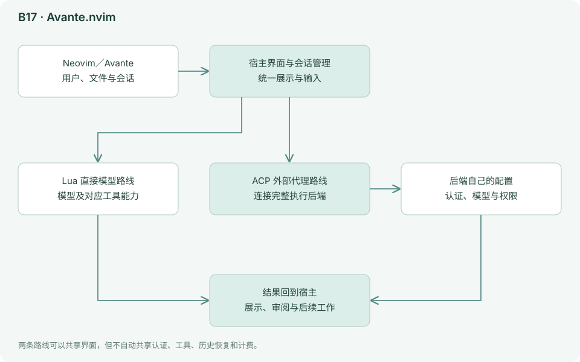

Lua 模型层区分直接调用 Provider 与 ACP 路径，并处理流、工具和记忆摘要。所检查的 `dispatch_agent` 面向独立的只读搜索任务，不能因此理解为一套默认可写文件的团队。ACP 路线又可能把代理运行交给 Codex、Gemini 等外部进程。[模型层](https://github.com/avante-corp/avante.nvim/blob/18316361891e59f3d18732fea0b1fe68c8be56e9/lua/avante/llm.lua)、[分派工具](https://github.com/avante-corp/avante.nvim/blob/18316361891e59f3d18732fea0b1fe68c8be56e9/lua/avante/llm_tools/dispatch_agent.lua)

直接 Provider 路线由插件组织模型消息和工具，ACP 路线则把完整代理职责交给外部进程。两者在编辑器里可能看起来相似，但认证、权限和恢复路径不同。源码中的 dispatch_agent 是受限的搜索分派，适合调查而非任意实施；不能看到一个 agent 名称就推断有完整可写团队。修改建议最后仍需按真实 diff 审查。

### 能力、状态与边界

| 观察项 | 实际机制／公开能力 | 对使用者意味着什么 |
|---|---|---|
| 工作位置 | Neovim 内的项目对话与编辑 | 使用已有缓冲区和键盘习惯 |
| 两条后端 | 直接模型与 ACP 外部代理 | 明确当前由谁管理工具循环 |
| 项目规则 | avante.md 等支持的指令 | 规则路径与生效范围按版本核对 |
| 独立调查 | 所核验 dispatch_agent 为只读搜索 | 不可据此推定可写团队或无限派生 |
| 依赖 | Neovim、插件及部分构建依赖 | 先确认基础插件正常，再调模型 |
| 成本与权限 | 由所选 Provider／外部代理决定 | 编辑器统一不代表账户与授权统一 |

### 资料依据与继续阅读

[README](https://github.com/avante-corp/avante.nvim/blob/18316361891e59f3d18732fea0b1fe68c8be56e9/README.md)、[模型层](https://github.com/avante-corp/avante.nvim/blob/18316361891e59f3d18732fea0b1fe68c8be56e9/lua/avante/llm.lua)、[分派工具](https://github.com/avante-corp/avante.nvim/blob/18316361891e59f3d18732fea0b1fe68c8be56e9/lua/avante/llm_tools/dispatch_agent.lua)。

源码链接指向固定提交；关键实现分析不等于对整个项目和依赖逐行审计。上面的结构与边界依据这些材料整理；当前安装方式、型号和菜单以官方最新文档为准。

## B18 CodeCompanion.nvim：把模型适配和完整代理接入明确分开

*简档：保留定位、总体结构和能力边界；上手命令、试用任务和模型路线不再随事实刷新维护，选型请参考[第 05 章的场景表](05-按场景选择组合.md)与[第 06 章的集中表](06-模型搭配与成本.md)。*

### 定位与设计理念

CodeCompanion 提供对话、局部转换、代码审查、工具和工作流，同时保留较强的编辑器配置自由。它适合希望在 Neovim 内按自己的习惯组合 AI 能力的人。[README](https://github.com/olimorris/codecompanion.nvim/blob/3af636c9892c70c5a4e91604718bf902076aff26/README.md)

CodeCompanion 把 Neovim 当作可组合的 AI 工作台，提供聊天、局部转换、审查与自定义工作流。它清楚区分模型适配和代理连接，使用户可以按任务选择：简单转换直接请求模型，复杂开发交给完整代理。灵活性很高，但用户要愿意明确每条路线的责任和配置。

### 工作原理与架构图

下图结合所引源码与文档，画出本工具的主要责任分工；为便于理解，省略次要模块与错误分支。

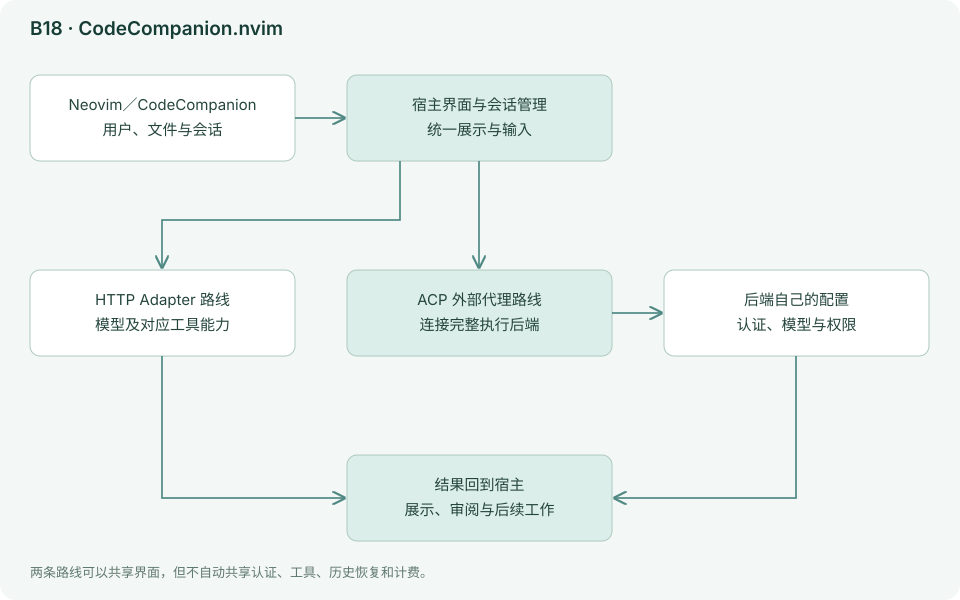

HTTP Adapter 处理模型请求、响应和工具格式；ACP Connection 处理外部代理的会话、能力、权限请求和流式更新。前者是“自己组织对话并请求模型”，后者是“把完整任务交给另一个代理”。两者都出现在同一编辑器里，但负责执行的人不同。[HTTP 适配](https://github.com/olimorris/codecompanion.nvim/blob/3af636c9892c70c5a4e91604718bf902076aff26/lua/codecompanion/adapters/http/init.lua)、[ACP 连接](https://github.com/olimorris/codecompanion.nvim/blob/3af636c9892c70c5a4e91604718bf902076aff26/lua/codecompanion/acp/init.lua)

HTTP Adapter 处理的是向模型发请求、解析流和工具格式；ACP Connection 处理的是与一个会自己执行任务的代理交流，包括会话更新与权限请求。前者类似给模型接插座，后者类似接一位完整同事。排错时先辨认这层边界：模型参数不支持与外部代理无法启动，不应采用同一种修复办法。

### 能力、状态与边界

| 观察项 | 实际机制／公开能力 | 对使用者意味着什么 |
|---|---|---|
| 交互 | Chat、局部转换、审查和工作流 | 根据编辑尺度选择，不把所有操作变成长任务 |
| HTTP Adapter | 模型消息与工具格式适配 | 兼容服务需核对参数和返回格式 |
| ACP Connection | 外部代理会话、能力及审批 | 代理模型与权限在相应后端配置 |
| 规则和扩展 | 可按需接规则、Skills、MCP 等 | 配置越多，越需保留最小可用基线 |
| 运行责任 | 插件与外部代理分工明确 | 同一界面下可能有不同状态保存方式 |
| 维护 | 编辑器、插件和后端共同变化 | 升级分批进行，便于定位失效层 |

### 资料依据与继续阅读

[README](https://github.com/olimorris/codecompanion.nvim/blob/3af636c9892c70c5a4e91604718bf902076aff26/README.md)、[HTTP 适配](https://github.com/olimorris/codecompanion.nvim/blob/3af636c9892c70c5a4e91604718bf902076aff26/lua/codecompanion/adapters/http/init.lua)、[ACP 连接](https://github.com/olimorris/codecompanion.nvim/blob/3af636c9892c70c5a4e91604718bf902076aff26/lua/codecompanion/acp/init.lua)。

源码链接指向固定提交；关键实现分析不等于对整个项目和依赖逐行审计。上面的结构与边界依据这些材料整理；当前安装方式、型号和菜单以官方最新文档为准。

## B19 Tabnine Agent：把企业模型选择与开发环境控制放在前面

*简档：保留定位、总体结构和能力边界；上手命令、试用任务和模型路线不再随事实刷新维护，选型请参考[第 05 章的场景表](05-按场景选择组合.md)与[第 06 章的集中表](06-模型搭配与成本.md)。*

### 定位与设计理念

Tabnine 当前不只有补全和 Chat，也有直接在开发环境中执行目标的 Agent。产品强调项目上下文、用户反馈和组织控制。对于已有企业部署约束的团队，模型治理和私有端点可能比追逐最新单一型号更重要。[Agent 说明](https://docs.tabnine.com/main/getting-started/tabnine-agent)

Tabnine Agent 把组织控制放在显眼位置。对于企业团队，能使用哪个模型、代码发到哪里、工具能执行什么，常常比单次回答的细微差别更重要。它适合在已有 IDE 和管理策略下引入代理；但企业治理能力需要按实际部署与合同确认，不能由一个“私有”标签推断所有数据路径。

### 工作原理与架构图

下图依据官方公开接口整理，表示责任分工，不代表已审计闭源内部实现。

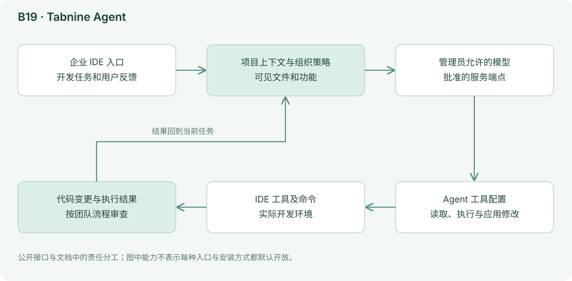

IDE 中的工具设置分别控制读取、命令和应用代码等能力；管理员可以决定组织可用的模型。完整商业核心未公开，因此本报告按公开配置描述其责任分工，不声称验证其内部调度算法。[工具设置](https://docs.tabnine.com/main/getting-started/tabnine-agent/agent-settings)

管理员选择可用模型，用户再在允许范围内发起任务；IDE 工具设置决定能读文件、运行命令或应用修改。它把模型治理与执行控制分开，但两者都需要验证。例如模型端点在内网，并不能说明某个工具不会访问外部网站；禁止执行命令，也不等于可以随意读取全部项目资料。完整商业核心未公开，内部调度不宜臆测。

### 能力、状态与边界

| 观察项 | 实际机制／公开能力 | 对使用者意味着什么 |
|---|---|---|
| 组织模型策略 | 管理员控制可用模型 | 实际可选目录以组织和入口为准 |
| 工具设置 | 读取、命令与代码应用分别控制 | 使用前核对有效授权而非仅看默认值 |
| 开发上下文 | IDE 项目与用户反馈 | 先选代表性仓库，确认项目理解有效 |
| 部署路线 | 企业与私有端点等方案 | 数据、日志和工具出口需按部署核对 |
| 模型范围 | 官方目录列多个模型家族 | 目录存在不代表每个入口均可使用 |
| 源码边界 | 商业完整运行时未公开 | 以公开能力及组织试点结果评价 |

### 资料依据与继续阅读

[Agent 说明](https://docs.tabnine.com/main/getting-started/tabnine-agent)、[工具设置](https://docs.tabnine.com/main/getting-started/tabnine-agent/agent-settings)、[模型目录](https://docs.tabnine.com/main/welcome/readme/ai-models)。

完整商业运行时未公开，结构判断以官方可见行为和接口为限。上面的结构与边界依据这些材料整理；当前安装方式、型号和菜单以官方最新文档为准。

## B20 Google Jules：把仓库任务交给独立云端工作机

*简档：保留定位、总体结构和能力边界；上手命令、试用任务和模型路线不再随事实刷新维护，选型请参考[第 05 章的场景表](05-按场景选择组合.md)与[第 06 章的集中表](06-模型搭配与成本.md)。*

### 定位与设计理念

Jules 是异步编码代理：连接 GitHub，选择仓库和分支，在云端虚拟机中克隆代码、安装依赖、修改并验证。它与 Gemini CLI 的主要差别是环境和任务生命周期由服务管理。当前入门文档仍标记实验性质，应保留成熟度判断。[入门](https://jules.google/docs)

Jules 把代码任务放到独立云端工作机上，让用户先交代需求，再回来查看计划与产物。与本机即时交互相比，它更依赖完整任务说明和可重复环境；优势是用户不必一直占用自己的终端。实验性质也意味着使用者应保留对功能变化、可用性和结果质量的观察。

### 工作原理与架构图

下图依据官方公开接口整理，表示责任分工，不代表已审计闭源内部实现。

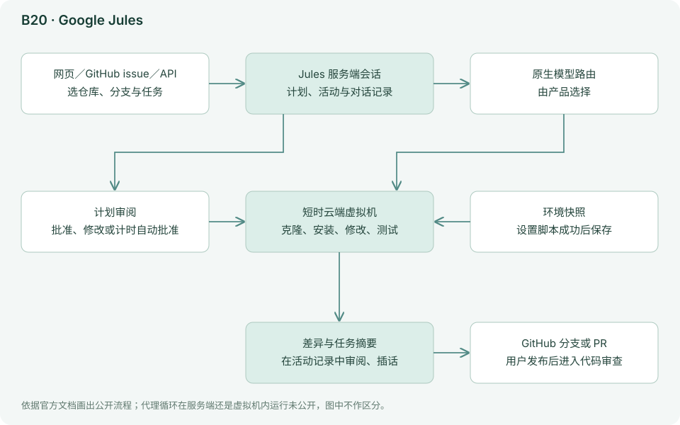

API 将源码来源、会话与活动分为不同对象，便于调用方持续跟踪任务状态与产物。云端环境要从仓库重新建立工作条件，本机正在运行的服务、未提交文件和个人环境变量不会自动出现。CLI 是服务入口，并不意味着同样的执行引擎被搬回本机。

### 能力、状态与边界

| 观察项 | 实际机制／公开能力 | 对使用者意味着什么 |
|---|---|---|
| 任务方式 | 异步云端编码 | 适合独立 issue 与批量维护 |
| 环境 | 独立虚拟机准备仓库与依赖 | 提供可重复安装和测试步骤 |
| API 对象 | Source、Session、Activity | 跟踪状态与产物，不能只看完成通知 |
| 项目规则 | 仓库说明及 AGENTS.md 等材料 | 未记录背景要补入任务或仓库 |
| 模型 | 原生模型路由 | 公开材料不支持任意 BYOK 的普遍承诺 |
| 成熟度 | 官方入门仍有实验性质说明 | 保持小范围试点与正常人工审查 |

### 资料依据与继续阅读

[入门](https://jules.google/docs)、[API](https://jules.google/docs/api/reference/)。

完整商业运行时未公开，结构判断以官方可见行为和接口为限。上面的结构与边界依据这些材料整理；当前安装方式、型号和菜单以官方最新文档为准。

