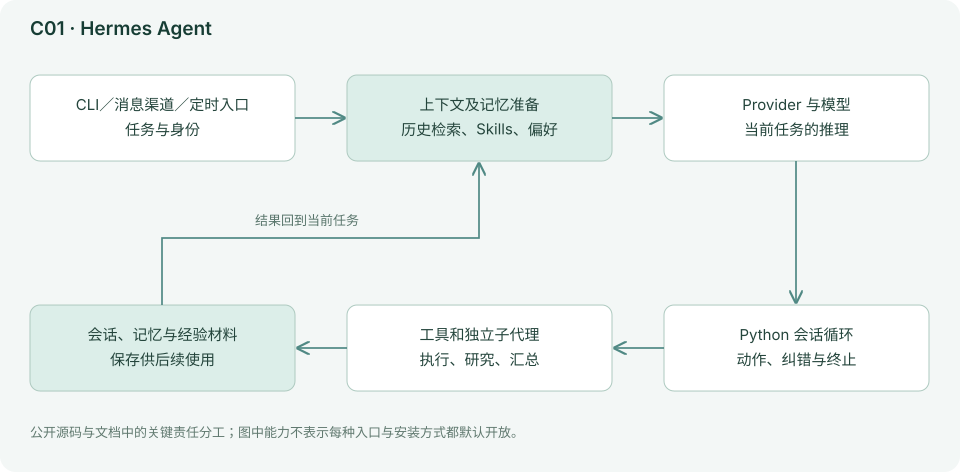
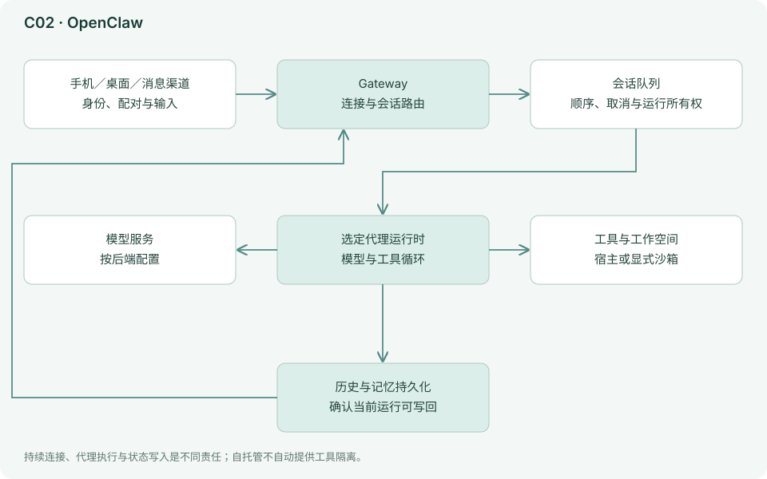
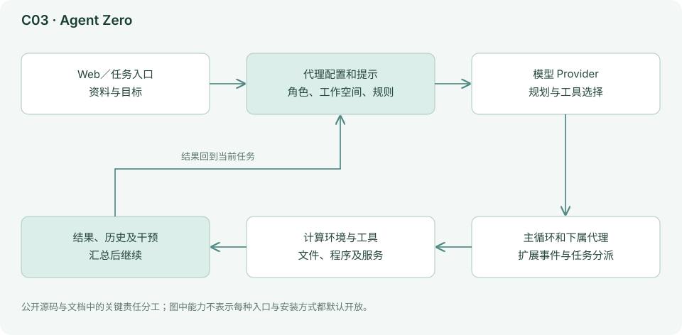
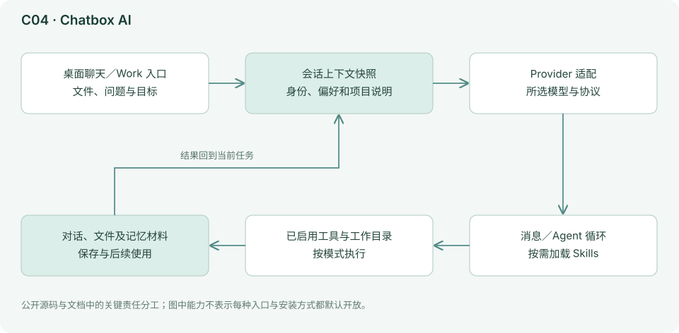
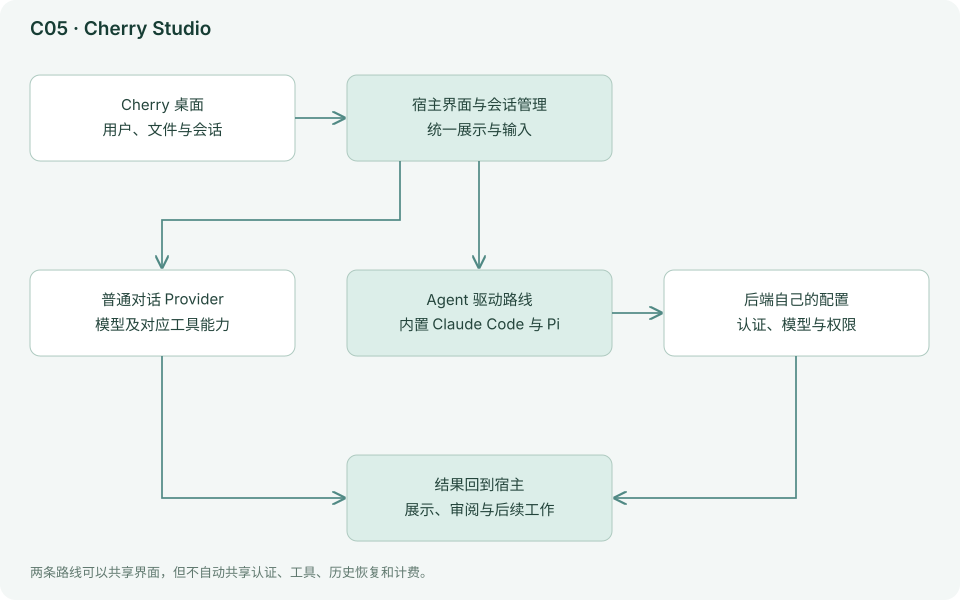
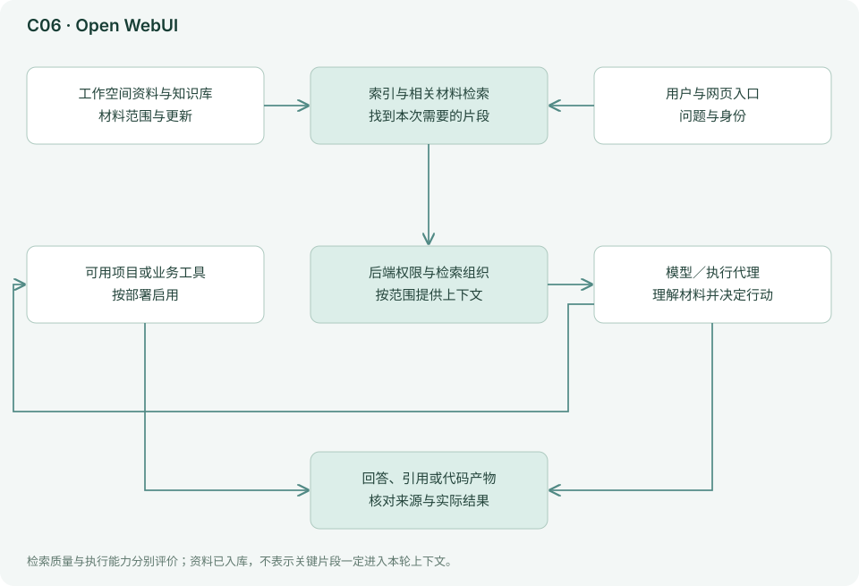
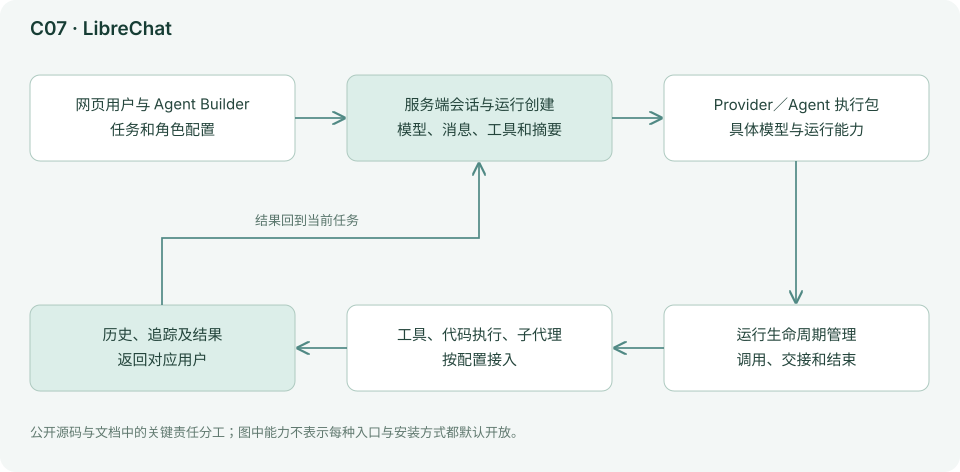
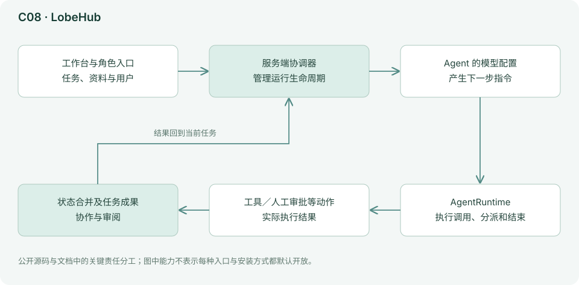
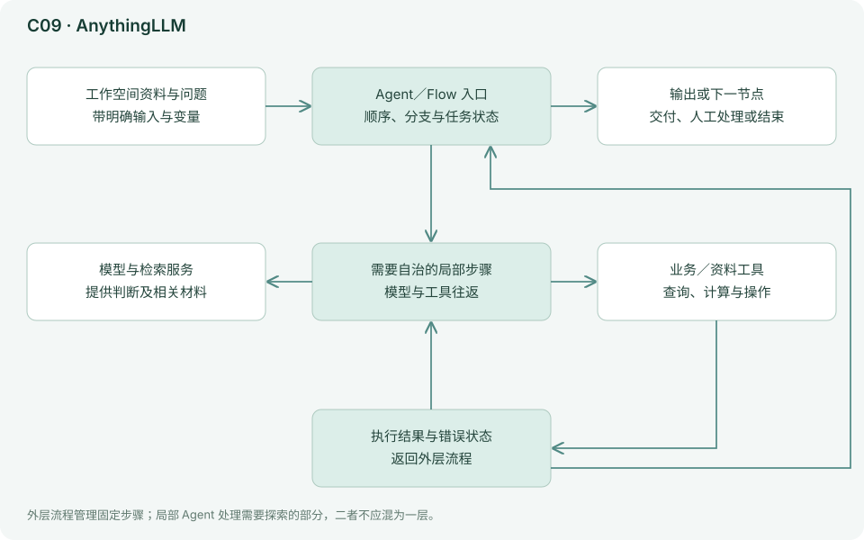

# 03C｜个人助理与知识工作台：围绕长期信息和日常工作组织代理

这类工具通常围绕人、资料、对话和外部应用组织工作。它们越来越多地加入代码执行、子代理、浏览器和定时任务，评估时需要同时了解这些执行与协作能力。

这里更需要问三个问题：**长期记忆存在哪里？谁能触发任务？代理操作的是哪个人的账户和工作空间？** 同样一次工具调用，放在一个临时编程会话中，与放在持续在线的聊天机器人里，管理难度很不一样。

**档案读法：** 工具档案分两层。重点档案是作者自己日常使用、会持续复查的工具，按七个维度完整展开，包括下一层架构图、上手步骤、试用任务和模型路线；简档保留定位、总体结构和能力边界。分层只反映本报告的维护范围，不代表产品优劣或推荐强度。本组均为简档。代码块是命令或操作示例，不表示本报告已经运行全部工具。

## C01 Hermes Agent：把一次任务的经验变成下一次可用的材料

*简档：保留定位、总体结构和能力边界；上手命令、试用任务和模型路线不再随事实刷新维护，选型请参考[第 05 章的场景表](05-按场景选择组合.md)与[第 06 章的集中表](06-模型搭配与成本.md)。*

### 定位与设计理念

Hermes 将长期使用放在中心：会话可以检索，经验可以写成记忆和 Skills，任务可以从 CLI、消息渠道或自动化入口到来。“会越用越懂你”在工程上主要意味着保存并重新使用材料，不是每聊一次就训练模型权重。[README](https://github.com/NousResearch/hermes-agent/blob/42c1a93417fa588e735736a0740787ce37381ffd/README.md)

Hermes 更关注长期使用而非单次回答。一次任务留下的经验、偏好与方法，可以在下一次被重新读取。其价值取决于保存的信息是否正确、是否能找回来以及是否及时修订。它适合有连续项目与重复工作的人；偶尔聊天的人未必需要承担多渠道和持续服务的配置成本。

### 工作原理与架构图

下图结合所引源码与文档，画出本工具的主要责任分工；为便于理解，省略次要模块与错误分支。

Python 会话循环把模型请求、上下文准备、工具分派和结果处理拆成多个部分；模型协议经适配后进入统一执行逻辑。记忆管理又通过独立 Provider 接口工作。在压缩前保存必要信息，是避免长任务丢失关键进展的一条路径。[循环](https://github.com/NousResearch/hermes-agent/blob/42c1a93417fa588e735736a0740787ce37381ffd/agent/conversation_loop.py)、[记忆管理](https://github.com/NousResearch/hermes-agent/blob/42c1a93417fa588e735736a0740787ce37381ffd/agent/memory_manager.py)

委派工具为子任务建立独立代理，主代理通常只看见任务与摘要，而不是所有中间步骤。源码还为子任务处理模型覆盖、工作树、取消和预算。特别要注意，子代理可以有自己的运行预算，父任务上限不能直接当作整棵任务树的总成本上限。[委派工具](https://github.com/NousResearch/hermes-agent/blob/42c1a93417fa588e735736a0740787ce37381ffd/tools/delegate_tool.py)

长期信息适合按用途分别保存，并在相关任务中取回。偏好描述你一般怎样工作，项目事实描述某个项目目前是什么样，Skill 描述一套可复用的方法，当前进度则记录这一项任务做到了哪里。Hermes 的记忆 Provider 和会话循环为这些材料提供保存与使用路径，但内容治理仍然重要。子代理拥有自己的上下文与预算，主任务得到汇总。适合长期保存的结论，应先经过核对，再写入记忆。

### 能力、状态与边界

| 观察项 | 实际机制／公开能力 | 对使用者意味着什么 |
|---|---|---|
| 长期材料 | 记忆、历史检索与 Skills | 经验复用依赖正确保存和命中，不是训练权重 |
| 压缩 | 上下文处理与压缩前的信息保存 | 关键事实应有可读出处，便于恢复核对 |
| 委派 | 独立代理、可选模型及工作树 | 任务描述需包含交付格式和证据要求 |
| 预算 | 子任务可以拥有自己的上限 | 父任务预算不自动等于整棵任务树总额 |
| 入口 | CLI、消息和自动化等路线 | 长期在线增加身份、服务与凭据管理 |
| 记忆治理 | 材料可积累，也需要修正 | 明确哪些是偏好、事实、临时判断与过期信息 |

### 资料依据与继续阅读

[README](https://github.com/NousResearch/hermes-agent/blob/42c1a93417fa588e735736a0740787ce37381ffd/README.md)、[循环](https://github.com/NousResearch/hermes-agent/blob/42c1a93417fa588e735736a0740787ce37381ffd/agent/conversation_loop.py)、[记忆管理](https://github.com/NousResearch/hermes-agent/blob/42c1a93417fa588e735736a0740787ce37381ffd/agent/memory_manager.py)、[委派工具](https://github.com/NousResearch/hermes-agent/blob/42c1a93417fa588e735736a0740787ce37381ffd/tools/delegate_tool.py)。

源码链接指向固定提交；关键实现分析不等于对整个项目和依赖逐行审计。上面的结构与边界依据这些材料整理；当前安装方式、型号和菜单以官方最新文档为准。

## C02 OpenClaw：让个人代理持续在线，连接不同渠道与设备

*简档：保留定位、总体结构和能力边界；上手命令、试用任务和模型路线不再随事实刷新维护，选型请参考[第 05 章的场景表](05-按场景选择组合.md)与[第 06 章的集中表](06-模型搭配与成本.md)。*

### 定位与设计理念

OpenClaw 更像个人代理的接线与运行中心。Gateway 维持长连接、渠道、会话和设备关系；手机、桌面、消息平台可以成为交互入口。它不只是把同一聊天框复制到几个应用。[架构文档](https://github.com/openclaw/openclaw/blob/b419a4add99ff917504ed26168babdbde6ac7ab6/docs/concepts/architecture.md)

OpenClaw 把个人代理做成持续在线的连接中心。来自手机、桌面与消息渠道的任务需要进入正确会话，再交给运行时执行。它关注的是：从不同入口发起任务时，怎样找到并接续自己的工作状态。持续连接带来便利，也要求清楚识别用户、设备和触发权限。

### 工作原理与架构图

下图结合所引源码与文档，画出本工具的主要责任分工；为便于理解，省略次要模块与错误分支。

Gateway 管理连接与任务进入方式，具体代理运行时负责模型和工具循环。当前文档已经涉及不同运行时路径，因此不宜永久把它概括成某一版本 Pi 的简单包装。每个会话的任务通常串行化，持久化写入还需要确认当前运行是否仍拥有写入资格，防止被替代的旧任务把过时状态写回去。[代理循环](https://github.com/openclaw/openclaw/blob/b419a4add99ff917504ed26168babdbde6ac7ab6/docs/concepts/agent-loop.md)

工作空间中的记忆材料、会话摘要、检索和后台整理共同服务持续使用。这里有一个实际取舍：记忆越多，维护和纠错越重要。能记住一句话不代表知道它何时过期，用户需要能够查看、修正和删除。[记忆设计](https://github.com/openclaw/openclaw/blob/b419a4add99ff917504ed26168babdbde6ac7ab6/docs/concepts/memory.md)

Gateway 类似接线台，负责把输入放进正确会话；代理运行时才决定下一步动作。同一会话通常需要串行处理，避免两次任务同时修改同一份状态。旧任务被替换后，持久化写入还要确认它是否仍有资格写回，否则可能覆盖新任务的正确结果。记忆文件、检索和整理提供长期连续性，但过时信息仍需要用户纠正。

### 能力、状态与边界

| 观察项 | 实际机制／公开能力 | 对使用者意味着什么 |
|---|---|---|
| 连接中心 | Gateway 管渠道、设备与会话 | 先验证谁能发指令，再开放更多入口 |
| 执行后端 | 多种运行时路径 | 后端决定模型、工具及部分权限行为 |
| 并发状态 | 会话串行与写入资格控制 | 避免旧任务覆盖新状态，关注取消后的行为 |
| 记忆 | 工作空间材料、摘要、检索与整理 | 要能查看、更正和删除，而非只积累 |
| 工具环境 | 宿主执行与显式沙箱分开 | 自托管不等于工具天然隔离 |
| 持续运行 | 多渠道和自动化依赖服务在线 | 备份、升级、失败恢复也是使用成本 |

### 资料依据与继续阅读

[架构文档](https://github.com/openclaw/openclaw/blob/b419a4add99ff917504ed26168babdbde6ac7ab6/docs/concepts/architecture.md)、[代理循环](https://github.com/openclaw/openclaw/blob/b419a4add99ff917504ed26168babdbde6ac7ab6/docs/concepts/agent-loop.md)、[记忆设计](https://github.com/openclaw/openclaw/blob/b419a4add99ff917504ed26168babdbde6ac7ab6/docs/concepts/memory.md)。

源码链接指向固定提交；关键实现分析不等于对整个项目和依赖逐行审计。上面的结构与边界依据这些材料整理；当前安装方式、型号和菜单以官方最新文档为准。

## C03 Agent Zero：给代理一套可以动手操作的工作环境

*简档：保留定位、总体结构和能力边界；上手命令、试用任务和模型路线不再随事实刷新维护，选型请参考[第 05 章的场景表](05-按场景选择组合.md)与[第 06 章的集中表](06-模型搭配与成本.md)。*

### 定位与设计理念

Agent Zero 偏向通用任务代理：让模型在可操作的计算环境中使用工具、编写程序、处理资料和分派任务。提示、工具、扩展和工作空间可以被用户修改，因此它兼具产品与实验平台的性质。[README](https://github.com/agent0ai/agent-zero/blob/b1cbd1f960a1a5c4482b324dcff4742aa67b7a51/README.md)

Agent Zero 把模型放进能实际操作的计算环境，使它可以写程序处理资料、调用工具并分派工作。它更像通用技术助理实验台：适应任务的方式很多，用户也能修改提示和工具。自由度越高，越需要清楚提供资料范围、输出要求与可操作环境，否则模型容易花很多时间探索而没有形成可用结果。

### 工作原理与架构图

下图结合所引源码与文档，画出本工具的主要责任分工；为便于理解，省略次要模块与错误分支。

`agent.py` 的循环反复准备提示、调用模型、处理工具，并在多个节点触发扩展与用户干预。子代理通过上下级关系和独立配置组织，具体任务可以交给不同职责的下属。这套设计容易扩展，但扩展一多，排查行为变化也更费力。[主循环](https://github.com/agent0ai/agent-zero/blob/b1cbd1f960a1a5c4482b324dcff4742aa67b7a51/agent.py)、[下属代理](https://github.com/agent0ai/agent-zero/blob/b1cbd1f960a1a5c4482b324dcff4742aa67b7a51/tools/call_subordinate.py)

主循环在准备提示、调用模型、处理工具等位置允许扩展介入，适合试验不同工作方法。下属代理拥有自己的配置与任务，主代理负责交接和汇总。容器给任务提供相对独立的环境，但挂载目录和外部凭据仍决定它能影响什么。验收时检查最终文件与计算过程，确认工具操作确实产出了所需结果。

### 能力、状态与边界

| 观察项 | 实际机制／公开能力 | 对使用者意味着什么 |
|---|---|---|
| 通用执行 | 文件、程序、资料与工具操作 | 输出应是可检查产物，而非操作数量 |
| 可修改性 | 提示、工具和扩展可调整 | 逐项改动，保留最小稳定配置 |
| 子代理 | 上下级关系与独立配置 | 需要明确任务输入、证据和汇总责任 |
| 执行环境 | 容器或文档支持的环境 | 挂载与凭据仍可让任务访问宿主和外部服务 |
| 用户干预 | 循环中的反馈与扩展节点 | 纠正后确认旧计划和新要求已对齐 |
| 模型要求 | 多轮工具、纠错和代码执行 | 小模型是否稳定要通过任务验证 |

### 资料依据与继续阅读

[README](https://github.com/agent0ai/agent-zero/blob/b1cbd1f960a1a5c4482b324dcff4742aa67b7a51/README.md)、[主循环](https://github.com/agent0ai/agent-zero/blob/b1cbd1f960a1a5c4482b324dcff4742aa67b7a51/agent.py)、[下属代理](https://github.com/agent0ai/agent-zero/blob/b1cbd1f960a1a5c4482b324dcff4742aa67b7a51/tools/call_subordinate.py)。

源码链接指向固定提交；关键实现分析不等于对整个项目和依赖逐行审计。上面的结构与边界依据这些材料整理；当前安装方式、型号和菜单以官方最新文档为准。

## C04 Chatbox AI：低门槛客户端正在长出真正的工作模式

*简档：保留定位、总体结构和能力边界；上手命令、试用任务和模型路线不再随事实刷新维护，选型请参考[第 05 章的场景表](05-按场景选择组合.md)与[第 06 章的集中表](06-模型搭配与成本.md)。*

### 定位与设计理念

Chatbox 的经典价值是多模型聊天、文件与对话管理，但当前公开技术文档已经描述 Agent／Work 模式、工具、Skills 和记忆。因此它不应再被一概排除在 Harness 讨论之外。商业发行版与社区源码也有差别，功能判断必须标注版本。[项目说明](https://github.com/chatboxai/chatbox/blob/0cf406cbd93197a89487c740cb101bef36641d35/README.md)、[功能页](https://chatboxai.app/en)

Chatbox 从熟悉的多模型聊天入口出发，逐渐加入真正会操作工作目录的模式。对于报告、翻译和资料讨论，用户可以先不理解复杂代理配置就开始；需要生成文件或执行任务时，再进入 Work／Agent 路线。把两种模式区分清楚，能避免用普通聊天的预期理解具有实际操作能力的工作会话。

### 工作原理与架构图

下图结合所引源码与文档，画出本工具的主要责任分工；为便于理解，省略次要模块与错误分支。

当前 Agent 模式将身份、Soul、个人偏好、工作目录说明与工具信息组装成提示；会话首次启动时保存一份上下文快照。稳定前缀有助于缓存和一致性，但代价是中途修改某些规则，不一定立刻影响这段既有会话，需要新会话或相应重捕获条件。[提示与记忆设计](https://github.com/chatboxai/chatbox/blob/0cf406cbd93197a89487c740cb101bef36641d35/docs/technical/agent-soul-memories.md)

Skills 则可以按需加载，避免把所有工作手册每次全塞进去。Provider 层区分模型配置和实际协议适配；“某服务兼容 OpenAI”并不意味着所有参数与推理行为一致。[Skills](https://github.com/chatboxai/chatbox/blob/0cf406cbd93197a89487c740cb101bef36641d35/docs/technical/agent-skills.md)、[Provider 设计](https://github.com/chatboxai/chatbox/blob/0cf406cbd93197a89487c740cb101bef36641d35/docs/technical/ai-providers.md)

稳定的上下文前缀有利于缓存和行为一致，代价是某些全局修改不会自动刷新旧会话。比如你修改报告语气偏好，既有任务仍可能沿用启动时的快照；可以先检查规则的生效条件，确认当前任务实际读取了哪些内容。Skills 按需加载帮助减少提示长度，但文件中的一次性事实应留在项目材料，不能全部塞进长期人格。

### 能力、状态与边界

| 观察项 | 实际机制／公开能力 | 对使用者意味着什么 |
|---|---|---|
| 入口难度 | Chat 与 Work／Agent 路线 | 先按任务选择是否需要实际工具执行 |
| 多模型 | Provider 与协议适配分层 | 兼容接口仍需核对参数及工具能力 |
| 上下文 | 首轮保存一定的上下文快照 | 改变规则后检查当前会话是否刷新 |
| 工作方法 | Skills 按需加载 | 常用写法与一次性事实分开管理 |
| 发行边界 | 社区源码与商业版本有差别 | 功能判断应记录实际版本 |
| 成果管理 | 对话、文件和目录任务 | 打开最终文件检查结构，而不只看聊天预览 |

### 资料依据与继续阅读

[项目说明](https://github.com/chatboxai/chatbox/blob/0cf406cbd93197a89487c740cb101bef36641d35/README.md)、[功能页](https://chatboxai.app/en)、[提示与记忆设计](https://github.com/chatboxai/chatbox/blob/0cf406cbd93197a89487c740cb101bef36641d35/docs/technical/agent-soul-memories.md)、[Provider 设计](https://github.com/chatboxai/chatbox/blob/0cf406cbd93197a89487c740cb101bef36641d35/docs/technical/ai-providers.md)。

源码链接指向固定提交；关键实现分析不等于对整个项目和依赖逐行审计。上面的结构与边界依据这些材料整理；当前安装方式、型号和菜单以官方最新文档为准。

## C05 Cherry Studio：多模型桌面工作台，也可以成为其他代理的宿主

*简档：保留定位、总体结构和能力边界；上手命令、试用任务和模型路线不再随事实刷新维护，选型请参考[第 05 章的场景表](05-按场景选择组合.md)与[第 06 章的集中表](06-模型搭配与成本.md)。*

### 定位与设计理念

Cherry 面向同时使用多个模型、资料和助手的人。当前架构已经从普通多模型对话扩展到独立 Agent Session 运行时，因此“多个模型各答一遍”和“多个代理分工执行”需要分别讨论。[README](https://github.com/CherryHQ/cherry-studio/blob/633729727543cfe7ccab776cc08e3a24fa7a925d/README.md)

Cherry Studio 希望把多模型、多资料与不同工作角色集中在一个桌面入口。用户可以比较回答，也可以选择实际执行任务的代理后端。二者不能混同：让三个模型各写一篇文章只是多份答案，真正分工还需要共同目标、状态交接与结果整合。统一工作台的便利主要在组织和切换，而不意味着底层能力完全一致。

### 工作原理与架构图

下图结合所引源码与文档，画出本工具的主要责任分工；为便于理解，省略次要模块与错误分支。

Electron 界面通过进程间通信交给主进程的 AI 服务；主进程负责流、持久化与不同消费者。Agent Session 又区分宿主服务与具体驱动：宿主管会话、排队、恢复标记和界面生命周期，驱动对接 Claude Code、Pi、DSH 等不同执行后端。这是“统一工作台＋不同引擎”的明确例子。[核心架构](https://github.com/CherryHQ/cherry-studio/blob/633729727543cfe7ccab776cc08e3a24fa7a925d/docs/references/ai/core-architecture.md)、[Agent Session](https://github.com/CherryHQ/cherry-studio/blob/633729727543cfe7ccab776cc08e3a24fa7a925d/docs/references/ai/agent-session-runtime.md)

这也带来边界：统一界面不意味着各后端的工具、审批和恢复语义完全一致。切换后端时，应确认原来的任务状态与权限怎样处理，而不只是看聊天记录还在不在。

界面通过进程间通信请求主进程服务，主进程管理输出与持久状态。Agent Session 的宿主负责排队、生命周期和恢复标记，具体驱动负责连接执行后端。这就像同一工作台可以接不同发动机：工作台能统一显示进度，却不能凭空让所有发动机获得相同工具和恢复语义。切换后端时，除模型外还要核对认证、目录和权限。

### 能力、状态与边界

| 观察项 | 实际机制／公开能力 | 对使用者意味着什么 |
|---|---|---|
| 桌面组织 | 模型、助手、资料与任务集中管理 | 方便整理，但要明确资料属于哪项任务 |
| 普通对话 | 可比较多个模型的回答 | 多个答案不自动构成协作或相互验证 |
| Agent 宿主 | 排队、持久化与会话生命周期 | 界面有历史不代表执行后端已恢复全部状态 |
| 代理驱动 | 连接 Claude、Pi、DSH 等后端 | 模型、工具和权限依驱动分别核对 |
| 数据路径 | 桌面、模型服务及工具后端 | 本地界面不能证明全部资料留在本机 |
| 迁移 | 资料、会话与代理配置分层 | 迁出前检查文件与历史是否真正可复用 |

### 资料依据与继续阅读

[README](https://github.com/CherryHQ/cherry-studio/blob/633729727543cfe7ccab776cc08e3a24fa7a925d/README.md)、[核心架构](https://github.com/CherryHQ/cherry-studio/blob/633729727543cfe7ccab776cc08e3a24fa7a925d/docs/references/ai/core-architecture.md)、[Agent Session](https://github.com/CherryHQ/cherry-studio/blob/633729727543cfe7ccab776cc08e3a24fa7a925d/docs/references/ai/agent-session-runtime.md)。

源码链接指向固定提交；关键实现分析不等于对整个项目和依赖逐行审计。上面的结构与边界依据这些材料整理；当前安装方式、型号和菜单以官方最新文档为准。

## C06 Open WebUI：自托管的共享 AI 门户，工具执行能力取决于部署

*简档：保留定位、总体结构和能力边界；上手命令、试用任务和模型路线不再随事实刷新维护，选型请参考[第 05 章的场景表](05-按场景选择组合.md)与[第 06 章的集中表](06-模型搭配与成本.md)。*

### 定位与设计理念

Open WebUI 常被用于为本地或远端模型提供统一网页入口。其能力已经延伸到用户权限、知识检索、工具、MCP／OpenAPI 接入以及终端执行相关能力。它既可能是一套聊天门户，也可能被配置成真正的代理工作台。[README](https://github.com/open-webui/open-webui/blob/8bd8b4fac5e059578ac0c74b3c18d11139f88b7d/README.md)

Open WebUI 常作为团队或个人的统一模型入口。它把用户、历史、知识与工具放在同一个网页服务里，可以连接本地模型，也可以连接云端。自托管使界面和部分数据可由自己管理，但完整数据路径还包括生成模型、嵌入、检索、搜索和工具，不能因为入口在内网就认定全链路离线。

### 工作原理与架构图

下图结合所引源码与文档，画出本工具的主要责任分工；为便于理解，省略次要模块与错误分支。

后端中间层组织消息、模型服务、检索与工具结果，工具模块再结合用户权限暴露能力。换句话说，模型本身未必知道你公司的全部数据，是后端决定哪些资料和工具能够进入这轮任务。[中间层](https://github.com/open-webui/open-webui/blob/8bd8b4fac5e059578ac0c74b3c18d11139f88b7d/backend/open_webui/utils/middleware.py)、[工具处理](https://github.com/open-webui/open-webui/blob/8bd8b4fac5e059578ac0c74b3c18d11139f88b7d/backend/open_webui/utils/tools.py)

一旦接上 Open Terminal 等执行能力，就必须检查每个用户的文件、进程和凭据边界。模型服务“只在内网”不能替代用户间隔离。插件或自定义代码也可能访问服务进程本身能够访问的资源。

用户提问时，后端决定哪些资料片段与工具可以进入当前上下文，再把它们交给模型。嵌入模型把资料转成便于检索的表示，生成模型负责根据找回的内容回答，两者可以在不同地方运行。增加终端执行后又多了一层进程与文件边界；如果所有用户共用同一个高权限环境，仅有网页登录并不能实现工具隔离。

### 能力、状态与边界

| 观察项 | 实际机制／公开能力 | 对使用者意味着什么 |
|---|---|---|
| 统一入口 | 用户、模型、历史和知识管理 | 多人使用需明确角色与资料可见范围 |
| 知识检索 | 后端组织相关材料 | 用已知答案测试引用，不只看文风 |
| 模型部署 | 本地或兼容云服务 | 生成与嵌入端点分别核对 |
| 外部工具 | MCP／OpenAPI 等接入路线 | 工具授权需匹配调用用户 |
| 执行扩展 | 可接终端等能力 | 检查用户间文件、进程和凭据隔离 |
| 服务维护 | 自托管入口与持久数据 | 备份、升级、配额和监控属于日常成本 |

### 资料依据与继续阅读

[README](https://github.com/open-webui/open-webui/blob/8bd8b4fac5e059578ac0c74b3c18d11139f88b7d/README.md)、[中间层](https://github.com/open-webui/open-webui/blob/8bd8b4fac5e059578ac0c74b3c18d11139f88b7d/backend/open_webui/utils/middleware.py)、[工具处理](https://github.com/open-webui/open-webui/blob/8bd8b4fac5e059578ac0c74b3c18d11139f88b7d/backend/open_webui/utils/tools.py)。

源码链接指向固定提交；关键实现分析不等于对整个项目和依赖逐行审计。上面的结构与边界依据这些材料整理；当前安装方式、型号和菜单以官方最新文档为准。

## C07 LibreChat：以对话产品为入口，扩展到可配置的 Agent 运行

*简档：保留定位、总体结构和能力边界；上手命令、试用任务和模型路线不再随事实刷新维护，选型请参考[第 05 章的场景表](05-按场景选择组合.md)与[第 06 章的集中表](06-模型搭配与成本.md)。*

### 定位与设计理念

LibreChat 将多 Provider、用户系统、历史和工具放在熟悉的聊天界面中，同时提供 Agent Builder、子代理／多代理和代码执行等能力。它适合希望自行托管一个统一 AI 工作入口的团队。[README](https://github.com/danny-avila/LibreChat/blob/ef89fbd5b3840ef9b628ab0763a862623cdce18b/README.md)

LibreChat 将熟悉的对话产品与可配置 Agent 结合，适合团队自建统一入口。用户系统、历史、模型、工具和 Agent Builder 在同一服务中组织，但共享一个 Agent 不等于共享所有人的权限。设计团队助理时，最重要的问题是资料从哪里来、工具以谁的身份执行、谁可以修改职责与配置。

### 工作原理与架构图

下图结合所引源码与文档，画出本工具的主要责任分工；为便于理解，省略次要模块与错误分支。

服务端创建运行时，将模型、消息、工具、摘要、子代理配置和追踪信息交给 Agent 执行包。它并非只转发一个 HTTP 请求；会话、工具发现和长期运行需要由服务端管理。但底层依赖的完整实现还在其他包里，本报告不把单个仓库的导入语句当作已经审计整个依赖树。[运行创建](https://github.com/danny-avila/LibreChat/blob/ef89fbd5b3840ef9b628ab0763a862623cdce18b/packages/api/src/agents/run.ts)、[客户端衔接](https://github.com/danny-avila/LibreChat/blob/ef89fbd5b3840ef9b628ab0763a862623cdce18b/packages/api/src/agents/client.ts)

服务端把模型、消息、工具与子代理配置交给执行包，再衔接会话与追踪。它不只是 HTTP 转发，但单个仓库中的封装也不等于底层依赖全被审计。共享 Agent 的配置与调用凭据尤其需要分开：某人能调用“销售助理”，不能据此推定他可以使用创建者的全部业务账户。用只读 Agent 起步，有助于先把知识与身份关系理顺。

### 能力、状态与边界

| 观察项 | 实际机制／公开能力 | 对使用者意味着什么 |
|---|---|---|
| 对话产品 | 多用户、历史与多个 Provider | 历史和资料需要按用户及共享规则管理 |
| Agent Builder | 配置职责、模型和工具 | 职责应包含来源和完成条件，不只是人格描述 |
| 运行层 | 服务端衔接独立执行包 | 审计边界要包含所依赖模块，不能只看导入语句 |
| 分工 | 可配置子代理／多代理等能力 | 明确输入、交接和最终核验责任 |
| 凭据 | 用户凭据与共享 Agent 配置有不同范围 | 逐项验证工具实际使用哪个账户 |
| 运维 | 服务、数据库和历史保存 | 部署之外还需备份、升级及失败诊断 |

### 资料依据与继续阅读

[README](https://github.com/danny-avila/LibreChat/blob/ef89fbd5b3840ef9b628ab0763a862623cdce18b/README.md)、[运行创建](https://github.com/danny-avila/LibreChat/blob/ef89fbd5b3840ef9b628ab0763a862623cdce18b/packages/api/src/agents/run.ts)、[客户端衔接](https://github.com/danny-avila/LibreChat/blob/ef89fbd5b3840ef9b628ab0763a862623cdce18b/packages/api/src/agents/client.ts)。

源码链接指向固定提交；关键实现分析不等于对整个项目和依赖逐行审计。上面的结构与边界依据这些材料整理；当前安装方式、型号和菜单以官方最新文档为准。

## C08 LobeHub：从“助手集合”走向有状态的协作工作台

*简档：保留定位、总体结构和能力边界；上手命令、试用任务和模型路线不再随事实刷新维护，选型请参考[第 05 章的场景表](05-按场景选择组合.md)与[第 06 章的集中表](06-模型搭配与成本.md)。*

### 定位与设计理念

LobeHub 已不能只按早期 LobeChat 的界面理解。当前方向包括 Agent、工具与协作，其价值是让不同职责的助手与任务状态在同一工作台中组织起来。[README](https://github.com/lobehub/lobehub/blob/035f1e7476eb8a3c66befb76f16ae25673d31e4a/README.md)

LobeHub 将助手、资料与有状态任务放在协作工作台中。一个角色可以负责研究，另一个负责写作，但真正的协作需要共享目标、可查证据和明确交接；不同名字与头像并不会自动形成分工。它适合希望把多种工作职责集中管理的人，同时要求用户避免过度创建角色造成信息分散。

### 工作原理与架构图

下图结合所引源码与文档，画出本工具的主要责任分工；为便于理解，省略次要模块与错误分支。

AgentRuntime 接收代理产生的指令，再执行调用模型、调用工具、请求人工审批或结束等动作。批量工具可从同一基础状态并行执行，再合并结果；服务端协调器负责更完整的运行生命周期。这样将“决定下一步”和“实际执行下一步”分开，便于扩展，但并行结果是否相互冲突仍需要上层语义处理。[运行时](https://github.com/lobehub/lobehub/blob/035f1e7476eb8a3c66befb76f16ae25673d31e4a/packages/agent-runtime/src/core/runtime.ts)、[协调器](https://github.com/lobehub/lobehub/blob/035f1e7476eb8a3c66befb76f16ae25673d31e4a/apps/server/src/modules/AgentRuntime/AgentRuntimeCoordinator.ts)

运行时把代理产生的指令转成具体动作，例如调用模型、使用工具、请求人工审批或结束。批量工具可以从同一份基础上下文出发再合并结果，这提高独立查询的效率；如果两项动作都要修改同一业务对象，仅有并发机制无法保证语义一致。角色设计应从任务边界出发：是否真的需要不同状态、工具和权限，还是只需换一个提示模板。

### 能力、状态与边界

| 观察项 | 实际机制／公开能力 | 对使用者意味着什么 |
|---|---|---|
| 角色组织 | Agent 与协作工作台 | 角色要有职责和交付件，不只换人设 |
| 有状态运行 | 指令与实际执行分开 | 完成状态要能对应真实产物 |
| 批量工具 | 从基础状态执行并汇总结果 | 独立查询可并行，冲突写入需额外设计 |
| 人工参与 | 运行时支持审批动作 | 明确何时需要人的判断及判断材料 |
| 模型 | 按 Provider 与角色配置 | 多模型结论一致也可能源自同一错误材料 |
| 部署 | 托管与自托管路线 | 多人权限和数据保存按实际部署核对 |

### 资料依据与继续阅读

[README](https://github.com/lobehub/lobehub/blob/035f1e7476eb8a3c66befb76f16ae25673d31e4a/README.md)、[运行时](https://github.com/lobehub/lobehub/blob/035f1e7476eb8a3c66befb76f16ae25673d31e4a/packages/agent-runtime/src/core/runtime.ts)、[协调器](https://github.com/lobehub/lobehub/blob/035f1e7476eb8a3c66befb76f16ae25673d31e4a/apps/server/src/modules/AgentRuntime/AgentRuntimeCoordinator.ts)。

源码链接指向固定提交；关键实现分析不等于对整个项目和依赖逐行审计。上面的结构与边界依据这些材料整理；当前安装方式、型号和菜单以官方最新文档为准。

## C09 AnythingLLM：围绕工作空间里的资料组织问答和流程

*简档：保留定位、总体结构和能力边界；上手命令、试用任务和模型路线不再随事实刷新维护，选型请参考[第 05 章的场景表](05-按场景选择组合.md)与[第 06 章的集中表](06-模型搭配与成本.md)。*

### 定位与设计理念

AnythingLLM 的自然起点是一个资料工作空间：导入文档、处理与建立索引、按问题检索，再由模型回答。Agent 与 Flow 在此基础上连接外部动作。因此它对“围绕一批固定资料反复工作”的任务很合适。[README](https://github.com/Mintplex-Labs/anything-llm/blob/d401491d67ee88c40d04ab67d71b7360ca6627b4/README.md)

AnythingLLM 围绕一批固定资料持续工作。用户先建立工作空间，把文档处理和检索准备好，再反复提问或运行资料流程。这特别适合手册、政策、项目档案和长期研究材料。它的效果不仅由回答模型决定，文档是否正确提取、切片和检索，常常更早决定答案是否可靠。

### 工作原理与架构图

下图结合所引源码与文档，画出本工具的主要责任分工；为便于理解，省略次要模块与错误分支。

文档处理、嵌入、向量检索、生成模型是不同部件，可以分开选择。执行层还有 Agent 对话管理与 Flow 执行器。当前所检查的 Flow 实现按步骤运行、传递变量，遇到错误或直接输出条件结束；这与让模型自由决定所有下一步的循环不同。[Agent 管理](https://github.com/Mintplex-Labs/anything-llm/blob/d401491d67ee88c40d04ab67d71b7360ca6627b4/server/utils/agents/aibitat/index.js)、[Flow](https://github.com/Mintplex-Labs/anything-llm/blob/d401491d67ee88c40d04ab67d71b7360ca6627b4/server/utils/agentFlows/executor.js)

导入文档后先提取内容，再形成适合检索的表示；提问时只找回相关片段交给生成模型。因此，“资料已经上传”不表示回答时真的看到了关键段落。Agent 可以根据任务选择动作，Flow 则按预先设置的步骤传递变量和处理结束条件。前者更灵活，后者更容易重复，应该按任务是否固定来选择。

### 能力、状态与边界

| 观察项 | 实际机制／公开能力 | 对使用者意味着什么 |
|---|---|---|
| 资料工作空间 | 围绕主题组织文档 | 主题与权限边界清楚，检索更容易验收 |
| 检索链 | 解析、嵌入、向量检索和生成分层 | 先查资料是否正确提取，再考虑换生成模型 |
| 引用 | 回答应能回到原始片段 | 引用存在不等于足以支持整句结论 |
| Agent | 工具与任务循环 | 适合步骤不完全确定的资料任务 |
| Flow | 步骤、变量与错误／输出条件 | 适合重复提取与固定处理流程 |
| 部署 | 桌面与多人服务能力不同 | 共享、权限和备份按实际版本设计 |

### 资料依据与继续阅读

[README](https://github.com/Mintplex-Labs/anything-llm/blob/d401491d67ee88c40d04ab67d71b7360ca6627b4/README.md)、[Agent 管理](https://github.com/Mintplex-Labs/anything-llm/blob/d401491d67ee88c40d04ab67d71b7360ca6627b4/server/utils/agents/aibitat/index.js)、[Flow](https://github.com/Mintplex-Labs/anything-llm/blob/d401491d67ee88c40d04ab67d71b7360ca6627b4/server/utils/agentFlows/executor.js)。

源码链接指向固定提交；关键实现分析不等于对整个项目和依赖逐行审计。上面的结构与边界依据这些材料整理；当前安装方式、型号和菜单以官方最新文档为准。

## 普通知识工作者还应认识的相邻产品

完全不想管理 Provider、运行环境和工具的人，也应比较原生托管工作产品，例如 **ChatGPT Work、Claude Cowork**。它们把模型、连接器和工作空间作为一套产品提供；与自由换模型的 Harness 相比，更接近整套办公服务。Claude Cowork 的官方说明强调围绕文件与应用执行工作；ChatGPT 的能力和模型则按具体产品与账户开放。[Cowork](https://claude.com/product/cowork)、[OpenAI 官方产品文档](https://learn.chatgpt.com/docs/llms.txt)

Manus 的官方资料还描述了持续运行的云端计算环境，属于值得关注的相邻路线。[Cloud Computer](https://help.manus.im/en/articles/15392111-what-is-the-cloud-computer) Genspark、Perplexity Computer、Kimi 的办公产品，以及各类 AI 应用生成器，也处于相邻市场。但本次没有对它们全部建立同等级源码／架构证据，因此不把它们混进“已深读的开放 Harness”数量。对于只想完成一份报告的用户，选择托管产品往往值得考虑；对于要研究和替换代理内部结构的人，开放 Harness 更合适。

同样，LM Studio、Ollama 主要帮助运行和服务模型；SillyTavern 等更偏创作／角色对话；LangGraph、AutoGen、CrewAI 等偏开发框架。它们可能进入一套完整方案，但不应与开箱即用的代理产品在同一张总分表里硬排高低。
