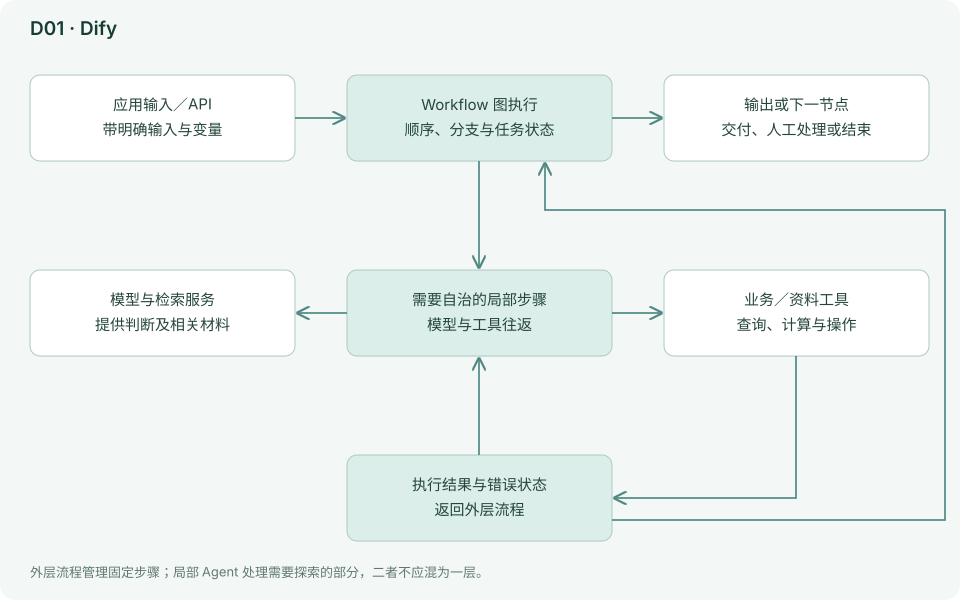
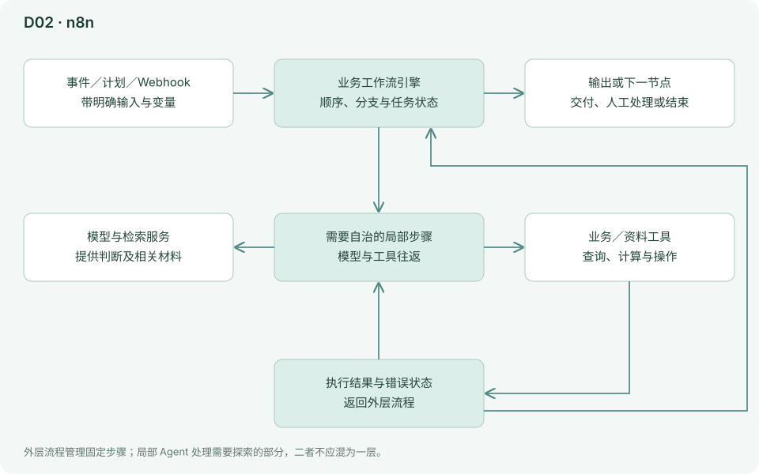
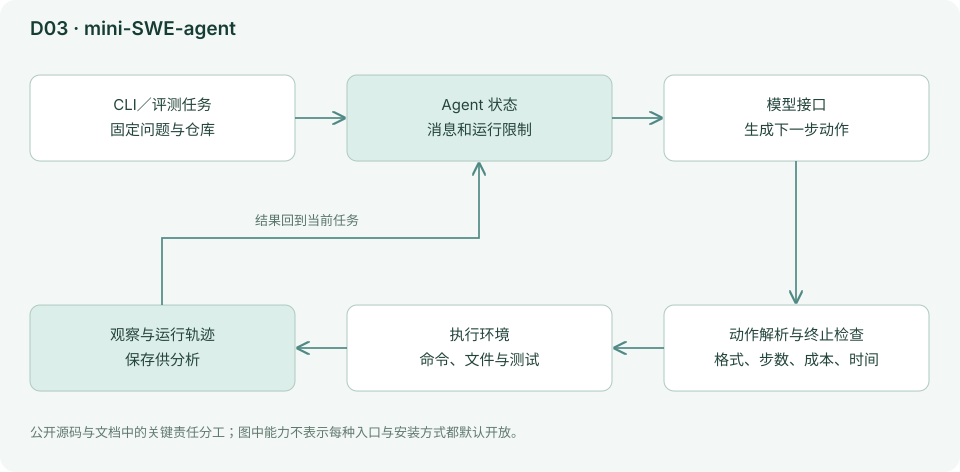
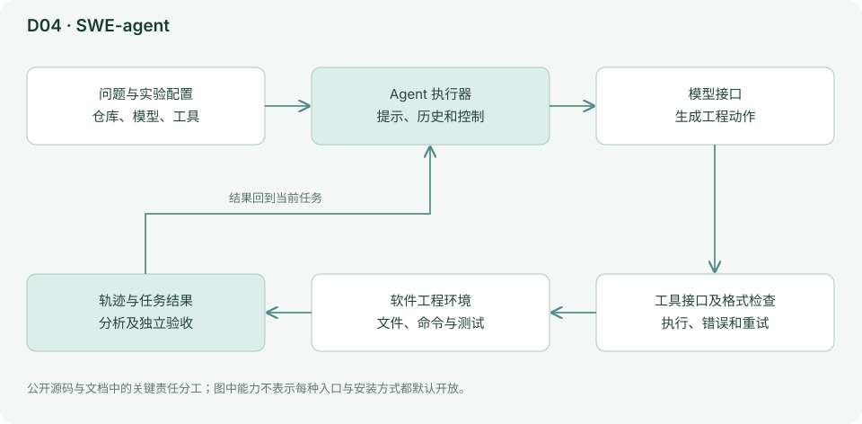
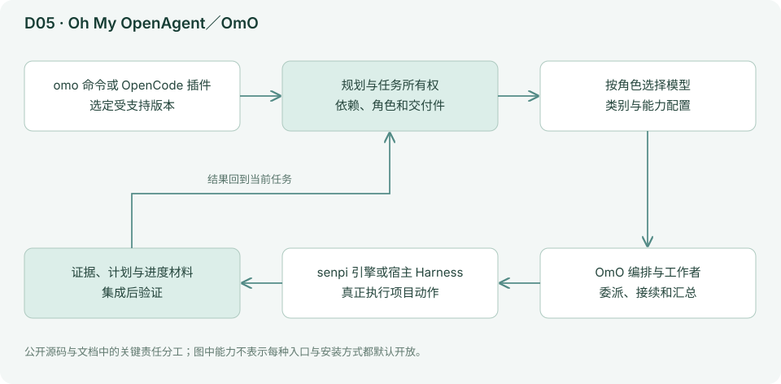
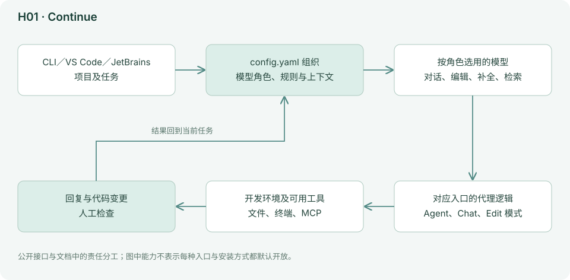
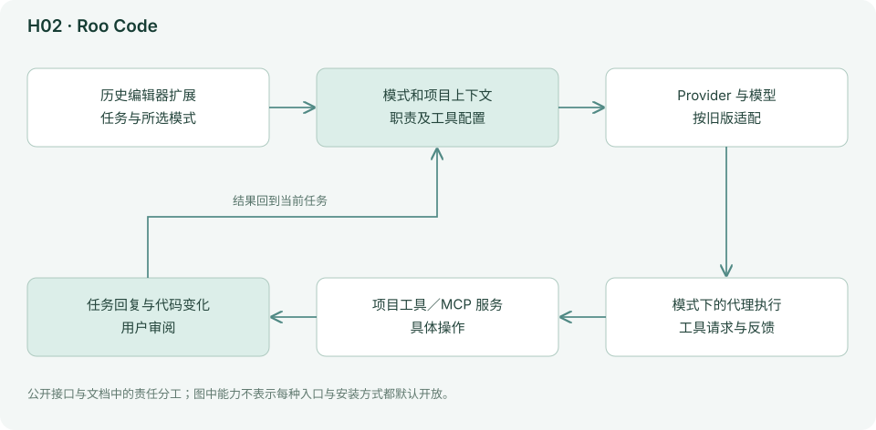
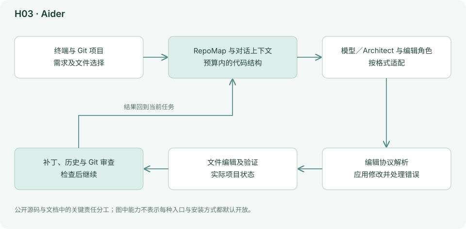
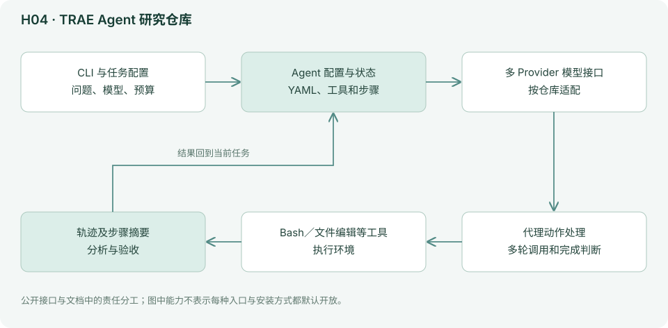

# 03D｜相邻路线与维护观察：结合当前维护状态理解项目

有些工具很重要，却不适合直接与一个桌面编码代理比较；另一些曾经流行，现在的维护状态需要重新判断。本章保留它们的研究价值，同时说明为什么不把它们全部作为新用户的默认推荐。

**档案读法：** 工具档案分两层。重点档案是作者自己日常使用、会持续复查的工具，按七个维度完整展开，包括下一层架构图、上手步骤、试用任务和模型路线；简档保留定位、总体结构和能力边界。分层只反映本报告的维护范围，不代表产品优劣或推荐强度。本组均为简档。代码块是命令或操作示例，不表示本报告已经运行全部工具。

## D01 Dify：把模型能力做成可复用的业务应用

*简档：保留定位、总体结构和能力边界；上手命令、试用任务和模型路线不再随事实刷新维护，选型请参考[第 05 章的场景表](05-按场景选择组合.md)与[第 06 章的集中表](06-模型搭配与成本.md)。*

### 定位与设计理念

Dify 更接近 AI 应用与流程平台。用户组织输入、知识检索、模型、工具、分支和输出，再将流程交给其他人使用。代码中，Workflow Entry 负责图运行状态、节点与事件，Agent Runner 则在需要自治的步骤中循环调用模型和工具。确定流程与代理循环可以同时存在。[README](https://github.com/langgenius/dify/blob/a068c47ea993ccc0f943131c274b7830b16de9f4/README.md)、[工作流入口](https://github.com/langgenius/dify/blob/a068c47ea993ccc0f943131c274b7830b16de9f4/api/core/workflow/workflow_entry.py)、[工具调用代理](https://github.com/langgenius/dify/blob/a068c47ea993ccc0f943131c274b7830b16de9f4/api/core/agent/fc_agent_runner.py)

Dify 的目标是把 AI 能力做成别人也能反复使用的应用。用户先设计输入、知识、模型、工具与分支，再让使用者提交数据。它不要求每次都让模型从头决定所有步骤，因此适合业务规则较稳定的任务。代理节点保留局部灵活性，外层流程则明确顺序与交接。

### 工作原理与架构图

下图结合所引源码与文档，画出本工具的主要责任分工；为便于理解，省略次要模块与错误分支。

它的好处是：业务逻辑不必每次依靠模型重新猜。例如客户问题先分类，再检索对应知识库，证据不足转人工。代价是需要设计和维护流程、变量、权限与失败分支。

假设客服问题先分类，再检索对应资料，最后生成回答：这三个步骤可以写进流程，不必每轮重新猜。某个节点需要灵活调查时，再使用 Agent Runner 循环调用工具。变量是步骤之间的交接单，字段写错会让下游拿不到输入；失败分支决定资料不足或工具报错时如何退出。图画得通并不代表业务规则已经正确，仍需代表性输入测试。

### 能力、状态与边界

| 观察项 | 实际机制／公开能力 | 对使用者意味着什么 |
|---|---|---|
| 流程 | 显式节点、分支与变量 | 适合重复任务，变更时需维护流程 |
| Agent 节点 | 局部多轮模型与工具循环 | 自治范围应限制在确有不确定性的环节 |
| 知识 | 检索材料参与应用回答 | 引用和缺失资料需要单独验收 |
| 模型 | 可按节点选择支持的 Provider | 不同节点的错误会累积到最终结果 |
| 发布 | 应用供其他用户或系统调用 | 测试版本与对外使用版本需区分 |
| 部署与许可 | 云服务、自托管与企业能力 | 按实际许可证和服务条款确认范围 |

### 资料依据与继续阅读

[README](https://github.com/langgenius/dify/blob/a068c47ea993ccc0f943131c274b7830b16de9f4/README.md)、[工作流入口](https://github.com/langgenius/dify/blob/a068c47ea993ccc0f943131c274b7830b16de9f4/api/core/workflow/workflow_entry.py)、[工具调用代理](https://github.com/langgenius/dify/blob/a068c47ea993ccc0f943131c274b7830b16de9f4/api/core/agent/fc_agent_runner.py)。

源码链接指向固定提交；关键实现分析不等于对整个项目和依赖逐行审计。上面的结构与边界依据这些材料整理；当前安装方式、型号和菜单以官方最新文档为准。

## D02 n8n：让代理进入已有的业务自动化

*简档：保留定位、总体结构和能力边界；上手命令、试用任务和模型路线不再随事实刷新维护，选型请参考[第 05 章的场景表](05-按场景选择组合.md)与[第 06 章的集中表](06-模型搭配与成本.md)。*

### 定位与设计理念

n8n 的起点是连接应用与触发流程，AI Agent 是其中可配置的节点。当前 Tools Agent 执行器建立模型、记忆、批处理等上下文，再将工具执行交还工作流引擎并接续结果，同时记录执行次数、失败类型和记忆读写等追踪信息。[README](https://github.com/n8n-io/n8n/blob/8012f017bc80a35cef0c3012033e9089c9db8e03/README.md)、[Tools Agent V3](https://github.com/n8n-io/n8n/blob/8012f017bc80a35cef0c3012033e9089c9db8e03/packages/@n8n/nodes-langchain/nodes/agents/Agent/agents/ToolsAgent/V3/execute.ts)

n8n 从业务自动化出发，AI Agent 是流程中的一类节点。表单、计划或应用事件先触发任务，流程把数据交给模型判断，再连接其他系统。这适合重复发生、输入输出位置明确的工作。模型处理语义不确定性，流程负责固定顺序；把二者分开，可以减少让模型自行决定全部业务动作的负担。

### 工作原理与架构图

下图结合所引源码与文档，画出本工具的主要责任分工；为便于理解，省略次要模块与错误分支。

这与终端代理最明显的差别在于“什么时候开始做事”：可以由表单、计划、Webhook 或应用事件触发；输入输出已经是业务数据。模型负责有不确定性的环节，外层流程负责顺序与交接。

模型可以决定调用哪个已暴露工具，而实际工具执行仍与工作流引擎衔接。引擎继续传递结果并保存运行状态，使排错能够定位到具体节点。自动重试需要格外考虑重复副作用：一次创建工单已成功、回执却丢失时，直接重跑可能创建两份。可以用业务唯一标识检查是否已经处理过，为重试提供可核查的依据。

### 能力、状态与边界

| 观察项 | 实际机制／公开能力 | 对使用者意味着什么 |
|---|---|---|
| 启动方式 | 计划、表单、Webhook 与应用事件 | 触发频率和输入质量影响整个系统 |
| 固定流程 | 节点、变量与状态记录 | 关键业务顺序应由流程明确表达 |
| 代理节点 | 模型、记忆、工具及批处理 | 限制为该任务需要的工具 |
| 连接器 | 跨应用读取和写入 | 核对账户身份、字段和授权范围 |
| 失败恢复 | 节点执行与错误追踪 | 重试前考虑重复创建、重复发送等副作用 |
| 许可 | 官方 fair-code 路线 | 源码可见不意味着任何商业用途都无条件开放 |

### 资料依据与继续阅读

[README](https://github.com/n8n-io/n8n/blob/8012f017bc80a35cef0c3012033e9089c9db8e03/README.md)、[Tools Agent V3](https://github.com/n8n-io/n8n/blob/8012f017bc80a35cef0c3012033e9089c9db8e03/packages/@n8n/nodes-langchain/nodes/agents/Agent/agents/ToolsAgent/V3/execute.ts)。

源码链接指向固定提交；关键实现分析不等于对整个项目和依赖逐行审计。上面的结构与边界依据这些材料整理；当前安装方式、型号和菜单以官方最新文档为准。

## D03 mini-SWE-agent：研究代理时，一个短循环有时比复杂平台更有用

*简档：保留定位、总体结构和能力边界；上手命令、试用任务和模型路线不再随事实刷新维护，选型请参考[第 05 章的场景表](05-按场景选择组合.md)与[第 06 章的集中表](06-模型搭配与成本.md)。*

### 定位与设计理念

mini-SWE-agent 强调小而可理解的执行核心，面向软件工程任务与评测。当前 v2 的 Agent 反复执行查询模型、执行动作、加入观察；它也有步数、成本、时间与格式错误终止条件，并保存运行轨迹。[README](https://github.com/SWE-agent/mini-swe-agent/blob/04d809ceab9df28f9adaed044884180159172930/README.md)、[核心实现](https://github.com/SWE-agent/mini-swe-agent/blob/04d809ceab9df28f9adaed044884180159172930/src/minisweagent/agents/default.py)

mini-SWE-agent 把研究所需的关键循环保持得很短：问模型、执行动作、加入观察，再重复。少量核心逻辑让人更容易知道实验改变了什么，也更容易检查轨迹。它不以提供完整个人助理产品为目标；缺少某些界面或长期记忆，可能是研究可解释性与简洁性的取舍。

### 工作原理与架构图

下图结合所引源码与文档，画出本工具的主要责任分工；为便于理解，省略次要模块与错误分支。

少量代码更容易理解实验中到底改变了什么。代价是完整产品通常还需要的用户管理、丰富 UI、长期个人记忆和业务连接器不属于这个核心目标。

循环中的每次观察都进入后续模型输入，运行限制防止无限持续。轨迹让研究者看到模型什么时候走错、工具返回了什么，以及终止是完成还是预算耗尽。比较模型或工具时固定其他变量，才能解释结果：同一模型、不同提示属于提示实验；同时换模型、环境和预算，则难以说清哪一项带来提升。

### 能力、状态与边界

| 观察项 | 实际机制／公开能力 | 对使用者意味着什么 |
|---|---|---|
| 核心 | 查询、动作、观察的短循环 | 适合教学与控制变量实验 |
| 限制 | 步数、成本、时间和格式错误 | 终止原因应与成功率一起报告 |
| 环境 | 软件工程任务的实际执行环境 | 依赖和测试基线必须可重复 |
| 记录 | 保存运行轨迹 | 用于解释失败，不能代替独立验收 |
| 模型 | 依接口选择可稳定调用的型号 | 评测需固定版本与采样条件 |
| 产品边界 | 不以完整多用户工作台为重心 | 个人记忆、权限治理与连接器需另行设计 |

### 资料依据与继续阅读

[README](https://github.com/SWE-agent/mini-swe-agent/blob/04d809ceab9df28f9adaed044884180159172930/README.md)、[核心实现](https://github.com/SWE-agent/mini-swe-agent/blob/04d809ceab9df28f9adaed044884180159172930/src/minisweagent/agents/default.py)。

源码链接指向固定提交；关键实现分析不等于对整个项目和依赖逐行审计。上面的结构与边界依据这些材料整理；当前安装方式、型号和菜单以官方最新文档为准。

## D04 SWE-agent：仍值得理解，但官方已把主力转向 mini

*简档：保留定位、总体结构和能力边界；上手命令、试用任务和模型路线不再随事实刷新维护，选型请参考[第 05 章的场景表](05-按场景选择组合.md)与[第 06 章的集中表](06-模型搭配与成本.md)。*

### 定位与设计理念

SWE-agent 对代理如何使用软件工程工具、怎样给模型设计可操作接口，有重要历史与研究价值。其执行器围绕模型、环境、工具、格式检查与重试推进任务。[核心实现](https://github.com/SWE-agent/SWE-agent/blob/3ea751c087f32b16e039a2233dd6eefecef325d5/sweagent/agent/agents.py)

SWE-agent 的研究价值在于把软件工程环境与模型可操作接口结合起来。工具怎样呈现文件、错误怎样反馈、动作格式怎样检查，都可能改变完成率。当前维护重点已转向 mini，因此本条主要用于复现实验与理解历史设计；新工作优先评估 mini 等当前路线。

### 工作原理与架构图

下图结合所引源码与文档，画出本工具的主要责任分工；为便于理解，省略次要模块与错误分支。

但当前 README 明确表示主要开发精力转向 mini-SWE-agent，并建议新用户优先采用后者。即使仓库近期有推送，也不能把它当成与 mini 同等优先的新路线。适合复现实验、读旧配置或维护已有项目；不列为本报告的新用户首选。[维护说明](https://github.com/SWE-agent/SWE-agent/blob/3ea751c087f32b16e039a2233dd6eefecef325d5/README.md)

工具接口是一种提供给模型的工作方式：怎样看文件、怎样定位内容、怎样修改和验证，都影响模型下一步判断。格式检查与重试帮助处理不合法输出，却不能保证合法动作本身正确。复现实验时必须保留原工具和环境配置；只保留模型名字，通常不足以解释论文或排行榜中的结果。

### 能力、状态与边界

| 观察项 | 实际机制／公开能力 | 对使用者意味着什么 |
|---|---|---|
| 研究目的 | 软件工程代理与工具接口设计 | 适合理解模型如何操作环境 |
| 执行 | 模型、工具、格式检查与重试 | 格式合法与任务成功是两个指标 |
| 配置 | 任务、环境与模型共同定义实验 | 固定依赖和提示才能复现 |
| 轨迹 | 保存过程供分析 | 检查真实补丁和测试，不只看最终文本 |
| 维护 | 官方主力转向 mini-SWE-agent | 近期推送不代表同等产品投入 |
| 使用建议 | 既有部署与历史实验仍可研究 | 新项目优先评估 mini 等更活跃路线 |

### 资料依据与继续阅读

[核心实现](https://github.com/SWE-agent/SWE-agent/blob/3ea751c087f32b16e039a2233dd6eefecef325d5/sweagent/agent/agents.py)、[维护说明](https://github.com/SWE-agent/SWE-agent/blob/3ea751c087f32b16e039a2233dd6eefecef325d5/README.md)。

源码链接指向固定提交；关键实现分析不等于对整个项目和依赖逐行审计。上面的结构与边界依据这些材料整理；当前安装方式、型号和菜单以官方最新文档为准。

## D05 Oh My OpenAgent／OmO：从叠加插件走向自带引擎的编排体系

*简档：保留定位、总体结构和能力边界；上手命令、试用任务和模型路线不再随事实刷新维护，选型请参考[第 05 章的场景表](05-按场景选择组合.md)与[第 06 章的集中表](06-模型搭配与成本.md)。*

### 定位与设计理念

当前仓库是 `oh-my-openagent`，不能一直按早期 OpenCode 插件的固定角色表介绍它。现行 README 把 OmO 介绍为一个独立的 `omo` 命令（npm 包名 `omo-ai`）：它运行在作者自己维护的 senpi 引擎上，README 称 senpi 是 Pi 的分支，编排功能直接内置，不需要先装宿主应用、再注册插件。OpenCode 插件版仍作为另一个版本存在，两者可以并行使用；从 OpenCode 版迁过来时运行一次 `omo setup`，它会搬运 Provider 密钥、MCP 服务、技能和模型选择。[README](https://github.com/code-yeongyu/oh-my-openagent/blob/d862a09a0cce8a77b14168bd68d5a29087b18d79/README.md)、[现行 README](https://raw.githubusercontent.com/code-yeongyu/oh-my-openagent/f90d45166da333c4533c4355afdb6a7e667515ea/README.md)、[从 OpenCode 迁移](https://raw.githubusercontent.com/code-yeongyu/oh-my-openagent/f90d45166da333c4533c4355afdb6a7e667515ea/docs/guide/migrating-from-opencode.md)

OmO 的核心是编排经验：什么时候先规划、怎样派任务、如何保留证据和继续工作。无论用独立的 `omo` 命令还是 OpenCode 插件版，它都不是一个模型，而是一套把任务组织起来的方法和工具。其收益来自把成熟任务习惯复用起来；代价是行为问题可能来自模型、引擎或宿主、编排配置中的任何一层。

### 工作原理与架构图

下图结合所引源码与文档，画出本工具的主要责任分工；为便于理解，省略次要模块与错误分支。

当前编排文档区分规划、执行、依赖图和团队模式。主代理保持任务所有权，通过任务工具委派；工作者可以按类别选择模型，探索与资料代理拥有受限职责。计划文件、进度状态与证据材料服务于继续执行和验证。[编排说明](https://github.com/code-yeongyu/oh-my-openagent/blob/d862a09a0cce8a77b14168bd68d5a29087b18d79/docs/guide/orchestration.md)

这类系统的收益在于把经验性的提示、任务拆分和复查做成可复用流程。代价是多了需要跟踪的层次：插件版要同时看模型、底层 Harness、插件与配置；独立版把引擎固定在 senpi 上，少了宿主版本的组合，但引擎本身的更新同样会影响结果。升级任何一层都应做回归任务。

依赖图表达哪项工作必须等另一项完成，主代理保留整体任务责任，工作者按职责交回材料。这能避免所有任务一次性并行导致接口互相猜测。计划和证据文件让恢复有依据，但如果工作者只交一句“已完成”，主任务仍无法可靠判断。现行版本以自带 senpi 引擎的 `omo` 命令为主，旧 OpenCode 插件名称和固定角色表不能代表全部现状。

### 能力、状态与边界

| 观察项 | 实际机制／公开能力 | 对使用者意味着什么 |
|---|---|---|
| 定位 | 独立的 omo 命令（内置 senpi 引擎）与 OpenCode 插件版并存 | 记录所用版本；插件版还要记录宿主与插件版本 |
| 规划 | 计划、依赖图与团队模式 | 先确定哪些任务真正独立 |
| 任务所有权 | 主代理统一负责委派与集成 | 有人完成局部不代表整体完成 |
| 工作者 | 按类别选择模型与职责 | 输入、输出和工具要明确 |
| 状态材料 | 计划、进度与证据用于接续 | 保存真实结果，避免空泛汇报 |
| 兼容维护 | 引擎、编排与配置持续演进；从插件版迁移用 omo setup | 升级或迁移后都应运行基线任务 |

### 资料依据与继续阅读

[README](https://github.com/code-yeongyu/oh-my-openagent/blob/d862a09a0cce8a77b14168bd68d5a29087b18d79/README.md)、[现行 README](https://raw.githubusercontent.com/code-yeongyu/oh-my-openagent/f90d45166da333c4533c4355afdb6a7e667515ea/README.md)、[从 OpenCode 迁移](https://raw.githubusercontent.com/code-yeongyu/oh-my-openagent/f90d45166da333c4533c4355afdb6a7e667515ea/docs/guide/migrating-from-opencode.md)、[编排说明](https://github.com/code-yeongyu/oh-my-openagent/blob/d862a09a0cce8a77b14168bd68d5a29087b18d79/docs/guide/orchestration.md)。

源码链接指向固定提交；关键实现分析不等于对整个项目和依赖逐行审计。上面的结构与边界依据这些材料整理；当前安装方式、型号和菜单以官方最新文档为准。

## 四个需要单独标记的旧项目／旧入口

| 项目 | 本次可核验事实 | 应怎样对待 |
|---|---|---|
| Continue | 当前 README 明确写不再积极维护，并发布最终 2.0.0；仓库元数据仍可能出现近期推送 | 保留历史与既有部署参考，新选型不列活跃首选 |
| Roo Code | 仓库已归档，README 说明扩展于 5 月 15 日关闭 | 不使用旧排行榜推荐新用户直接投入；分支或后续产品需重新核验 |
| Aider | 仓库仍未归档，但本次 API 快照最后推送为 2026-05-22 | 标记维护观察，不武断宣称停更或不可用 |
| `bytedance/trae-agent` | 本次仓库快照最后推送为 2026-02-05 | 与商业 TRAE 产品分开，作为研究代码观察项 |

来源：[Continue](https://github.com/continuedev/continue/blob/5522c6f44ca0ac3528b37244818fbfa39b5af470/README.md)、[Roo](https://github.com/RooCodeInc/Roo-Code/blob/b867ec9145750d0ae1ff7f02d35406e9bf2a0b16/README.md)、[Aider 仓库](https://github.com/Aider-AI/aider)、[TRAE Agent 仓库](https://github.com/bytedance/trae-agent)。具体抓取时间、提交和数值见[仓库快照表](../research/repository-snapshot.csv)。

## H01 Continue：理解可配置编码助手，也要尊重维护结论

*简档：保留定位、总体结构和能力边界；上手命令、试用任务和模型路线不再随事实刷新维护，选型请参考[第 05 章的场景表](05-按场景选择组合.md)与[第 06 章的集中表](06-模型搭配与成本.md)。*

### 定位与设计理念

Continue 曾将 CLI、VS Code 和 JetBrains 入口与开放模型配置结合。所保存 README 明确写不再积极维护，并说明最终 2.0.0 发行。因此本条用于既有部署、历史设计与迁移参考，不把它作为新用户的活跃首选。[README 与最终发行](https://github.com/continuedev/continue/blob/5522c6f44ca0ac3528b37244818fbfa39b5af470/README.md)

它当初要解决的问题是：用户想在熟悉的编辑器或终端里使用编码代理，同时自己决定每类工作用哪个模型、项目规则写在哪里。与把模型和界面绑在一起的商业助手不同，Continue 把这些选择写进一份由用户维护的开放配置文件。同属维护观察的 Roo Code（H02）用“模式”区分工作意图，Continue 则用“模型角色”区分模型分工。项目不再积极维护后，这套设计仍值得参考，但已有部署要先盘点：哪些是通用项目资料，哪些依赖插件内部机制，再决定继续使用还是迁移。

### 工作原理与架构图

下图依据所引公开文档概括职责，不代表完整源码审计或对现有服务可用性的确认。

以下依据固定提交中的 README、文档与配置定义概括它当初怎样工作，没有重新安装运行。核心是一份 YAML 配置，用户级文件位于用户目录的 `.continue/config.yaml`。配置里列出若干模型，每个模型用 `roles` 声明承担哪些工作：对话（chat）、行内补全（autocomplete）、按指令改代码（edit）、把修改落到文件（apply）、为代码库和文档检索生成向量（embed）以及对检索结果重新排序（rerank），定义里还有 summarize 和 subagent；界面上再为每个角色选出当前使用的模型。这样，补全可以交给便宜快速的模型，对话和改代码交给更强的模型。项目规则写成 `.continue/rules` 目录下的 Markdown 文件，可以按文件路径匹配或设为总是生效，并按顺序拼进 Agent、Chat 和 Edit 模式的系统提示；补全和 apply 不带规则。配置里还可以声明上下文来源、MCP 服务器、提示词和文档，`@Codebase`、`@Docs` 这类引用依靠 embed 角色建立的向量检索。[模型角色](https://github.com/continuedev/continue/blob/5522c6f44ca0ac3528b37244818fbfa39b5af470/docs/customize/model-roles/intro.mdx)、[规则](https://github.com/continuedev/continue/blob/5522c6f44ca0ac3528b37244818fbfa39b5af470/docs/customize/deep-dives/rules.mdx)、[配置定义](https://github.com/continuedev/continue/blob/5522c6f44ca0ac3528b37244818fbfa39b5af470/packages/config-yaml/src/schemas/index.ts)、[配置位置](https://github.com/continuedev/continue/blob/5522c6f44ca0ac3528b37244818fbfa39b5af470/docs/customize/deep-dives/configuration.mdx)

迁移时，这些东西的去向不同。`.continue/rules` 里的 Markdown 规则是普通文本，可以整理成 `AGENTS.md` 或新工具的规则目录；模型角色要在新工具里逐项找对应位置，很多工具只区分主模型和辅助模型，补全往往由另一个插件负责；检索索引和界面里为各角色选定的模型无法直接带走，需要在新工具中重建。迁移最容易出错的是只保留了模型名字，却没有迁移规则的生效范围、上下文来源和验收条件。

### 能力、状态与边界

| 观察项 | 实际机制／公开能力 | 对使用者意味着什么 |
|---|---|---|
| 入口 | CLI、VS Code 扩展与 JetBrains 插件；README 建议用 CLI 代替 JetBrains 插件 | 先记录当前仍在使用的入口与版本 |
| 模型角色 | config.yaml 中按 chat、autocomplete、edit、apply、embed、rerank 等角色分配模型 | 迁移时逐项找对应位置，旧适配不保证支持新型号 |
| 项目规则 | .continue/rules 下的 Markdown 规则，可按路径匹配，拼入系统提示 | 可整理成 AGENTS.md 等通用规则文件 |
| 上下文 | 上下文来源、文档与 MCP；@Codebase、@Docs 依赖向量检索 | 检索索引换工具后要重建 |
| 维护状态 | README 写明不再积极维护、仓库对所有用户只读，并发布最终 2.0.0 | 不能用零星推送替代维护承诺 |
| 迁移 | 选择维护中的替代入口 | 用完整任务验证，不只测试聊天接通 |

### 资料依据与继续阅读

[README 与最终发行](https://github.com/continuedev/continue/blob/5522c6f44ca0ac3528b37244818fbfa39b5af470/README.md)、[模型角色](https://github.com/continuedev/continue/blob/5522c6f44ca0ac3528b37244818fbfa39b5af470/docs/customize/model-roles/intro.mdx)、[规则](https://github.com/continuedev/continue/blob/5522c6f44ca0ac3528b37244818fbfa39b5af470/docs/customize/deep-dives/rules.mdx)、[配置定义](https://github.com/continuedev/continue/blob/5522c6f44ca0ac3528b37244818fbfa39b5af470/packages/config-yaml/src/schemas/index.ts)。

此处主要依据公开说明与维护声明，未重新安装验证旧版本的全部功能。上面的结构与边界依据这些材料整理；当前安装方式、型号和菜单以官方最新文档为准。

## H02 Roo Code：保留多模式工作经验，重新选择维护中的执行入口

*简档：保留定位、总体结构和能力边界；上手命令、试用任务和模型路线不再随事实刷新维护，选型请参考[第 05 章的场景表](05-按场景选择组合.md)与[第 06 章的集中表](06-模型搭配与成本.md)。*

### 定位与设计理念

Roo 的历史产品重心是编辑器内的多模式代理，README 列出 Code、Architect、Ask、Debug 和自定义模式，以及 MCP 等能力。当前仓库已归档，README 说明扩展关闭。它仍可用于理解旧工作流，但不能据此推荐新用户继续依赖旧服务。[README 与模式说明](https://github.com/RooCodeInc/Roo-Code/blob/b867ec9145750d0ae1ff7f02d35406e9bf2a0b16/README.md)

多模式将工作意图显式区分：规划、提问、调试和实施各有关注点，用户可按任务切换。它能帮助组织工作，但模式名称本身并不构成权限保障，真正的执行边界还取决于配置与工具。项目关闭后，这些方法仍可带到其他工具，旧服务和旧插件则需要单独评估。

### 工作原理与架构图

下图依据所引公开文档概括职责，不代表完整源码审计或对现有服务可用性的确认。

模式可以改变提示与允许使用的能力，让同一个代理先分析再实施；这与启动多个独立工作者并不一样。迁移自定义模式时，把原来的用途落实为新工具的规则、权限和任务说明。某些模式允许命令时，即便名字叫 Architect，也不能默认它没有写入能力。

### 能力、状态与边界

| 观察项 | 实际机制／公开能力 | 对使用者意味着什么 |
|---|---|---|
| 工作方法 | Code、Architect、Ask、Debug 等模式 | 按职责理解，不凭名字推断安全边界 |
| 自定义 | 可建立自己的工作模式 | 迁移时重新表达工具与权限 |
| 扩展 | MCP 等外部能力 | 服务授权与配置需要重新核对 |
| 维护 | 仓库归档且扩展关闭 | 旧排行榜不构成继续投入的依据 |
| 替代 | 可在其他代理中复用方法 | 同源项目也不保证全部行为相同 |
| 历史记录 | 代码与任务经验仍有价值 | 导出关键规则与真实成果，减少私有状态依赖 |

### 资料依据与继续阅读

[README 与模式说明](https://github.com/RooCodeInc/Roo-Code/blob/b867ec9145750d0ae1ff7f02d35406e9bf2a0b16/README.md)。

此处主要依据公开说明与维护声明，未重新安装验证旧版本的全部功能。上面的结构与边界依据这些材料整理；当前安装方式、型号和菜单以官方最新文档为准。

## H03 Aider：项目地图、编辑协议与 Git 紧密结合

*简档：保留定位、总体结构和能力边界；上手命令、试用任务和模型路线不再随事实刷新维护，选型请参考[第 05 章的场景表](05-按场景选择组合.md)与[第 06 章的集中表](06-模型搭配与成本.md)。*

### 定位与设计理念

Aider 将代码地图、模型适合的编辑格式与 Git 工作流结合。仓库快照未归档，但推送间隔值得继续观察；这不足以断言不可用，也不足以证明当前所有新模型已适配。[仓库](https://github.com/Aider-AI/aider)

Aider 的鲜明路线是把有限上下文用在重要代码结构上，并采用适合模型的编辑协议。它不需要为每项改动建立复杂团队，也能通过明确输入、编辑和 Git 审查完成工作。项目地图帮助模型了解仓库，但它是压缩表示，无法替代必要时阅读实际实现。

### 工作原理与架构图

下图结合所引源码与文档，画出本工具的主要责任分工；为便于理解，省略次要模块与错误分支。

RepoMap 用有限预算表示仓库中的重要结构；编辑核心负责把模型输出变成代码修改。Architect 路线将提出方案与具体编辑分开，说明不依赖复杂团队编排也能形成清楚分工。[项目地图](https://github.com/Aider-AI/aider/blob/5dc9490bb35f9729ef2c95d00a19ccd30c26339c/aider/repomap.py)、[编辑核心](https://github.com/Aider-AI/aider/blob/5dc9490bb35f9729ef2c95d00a19ccd30c26339c/aider/coders/base_coder.py)

项目地图从代码结构中挑选重要信息，帮助模型知道相关文件和符号在哪里；编辑核心再将模型回复解析为实际修改。若模型频繁生成无法应用的编辑，问题可能在协议匹配而非理解能力。Architect 分工则让强模型先描述方案、另一模型具体编辑，节省与否要看交接遗漏和重试成本。

### 能力、状态与边界

| 观察项 | 实际机制／公开能力 | 对使用者意味着什么 |
|---|---|---|
| 上下文 | RepoMap 提供有预算的结构表示 | 地图帮助定位，关键实现仍需读取 |
| 编辑 | 按模型适配修改格式 | 聊天质量好不保证补丁可应用 |
| 职责分工 | Architect 与编辑角色 | 计划必须清楚传给编辑者 |
| Git | 变更与版本工作流紧密结合 | 查看实际 diff，保留原有用户修改 |
| 维护观察 | 快照未归档，但更新间隔值得关注 | 不能直接宣布停更或保证新模型兼容 |
| 试用 | 适合有限范围的代码修改 | 总成本包含格式失败与返工 |

### 资料依据与继续阅读

[仓库](https://github.com/Aider-AI/aider)、[项目地图](https://github.com/Aider-AI/aider/blob/5dc9490bb35f9729ef2c95d00a19ccd30c26339c/aider/repomap.py)、[编辑核心](https://github.com/Aider-AI/aider/blob/5dc9490bb35f9729ef2c95d00a19ccd30c26339c/aider/coders/base_coder.py)、[官方模型说明](https://aider.chat/docs/llms.html)。

源码链接指向固定提交；关键实现分析不等于对整个项目和依赖逐行审计。上面的结构与边界依据这些材料整理；当前安装方式、型号和菜单以官方最新文档为准。

## H04 TRAE Agent 研究仓库：研究可修改循环，与商业 TRAE 分开判断

*简档：保留定位、总体结构和能力边界；上手命令、试用任务和模型路线不再随事实刷新维护，选型请参考[第 05 章的场景表](05-按场景选择组合.md)与[第 06 章的集中表](06-模型搭配与成本.md)。*

### 定位与设计理念

`bytedance/trae-agent` 是研究导向的开放代理代码。README 描述多 Provider、文件与 Bash 工具、步骤摘要、轨迹记录及 YAML 配置；其自述仍写积极开发，而仓库快照显示较长推送间隔，两种信息应一起保留。本报告列为维护观察，不替它推断商业 TRAE 的能力或活跃度；商业产品自 2026-10-09 起已把原 TRAE IDE 与 TRAE Work 合并为一个新 TRAE，分 Agent Mode 与 IDE Mode 两种模式，见 [B07](03B-编辑器与托管工作台.md#b07)。[README](https://github.com/bytedance/trae-agent/blob/e839e559ac61bdd0e057c375dd1dee391fee797d/README.md)

该研究仓库强调模块化、可修改和轨迹可观察性，适合学习或比较代理方法。模型、工具、步数与记录可通过配置组合，方便研究者改变一项设计后观察结果。商业 TRAE 的产品体验、账户和内部模型不能从这里反推，两者即使名称相关，也不是同一个研究对象。

### 工作原理与架构图

下图依据所引公开文档概括职责，不代表完整源码审计或对现有服务可用性的确认。

YAML 配置为模型与代理建立对应关系，步数限制约束运行，轨迹记录为失败分析保留过程。简短步骤摘要方便阅读，但不应替代完整工具结果。研究时应先找到造成失败的具体一轮，再判断是输入、模型输出、工具解析还是环境问题；仅比较最终成功文字会丢掉最有用的信息。

### 能力、状态与边界

| 观察项 | 实际机制／公开能力 | 对使用者意味着什么 |
|---|---|---|
| 定位 | 开放研究代码，非商业产品完整运行时 | 不以此证明商业 TRAE 的内部设计 |
| 模型 | README 列出多个 Provider | 旧示例型号需要重新核对可用性 |
| 配置 | YAML、环境变量及步骤预算 | 配置与版本一起保存才可复现 |
| 工具 | 文件编辑、Bash 与其他研究工具 | 按实际执行环境判断权限 |
| 记录 | 轨迹与 Lakeview 等步骤摘要 | 摘要辅助阅读，验收回到原始结果 |
| 维护 | 自述与推送间隔存在需观察之处 | 不将旧 README 的活跃措辞当最新保证 |

### 资料依据与继续阅读

[README](https://github.com/bytedance/trae-agent/blob/e839e559ac61bdd0e057c375dd1dee391fee797d/README.md)。

此处主要依据公开说明与维护声明，未重新安装验证旧版本的全部功能。上面的结构与边界依据这些材料整理；当前安装方式、型号和菜单以官方最新文档为准。

## 另外三种“看似停更，其实是迁移”

- **Pi**：使用当前 `earendil-works/pi`，安装与文档以当前仓库为准。
- **Kimi**：当前 `kimi-code` 与旧 `kimi-cli` 不应按同一套源码架构描述。
- **Copilot Chat**：旧仓库归档后，编辑器侧开发迁入 VS Code；这不等于产品终止。

这也是为什么本报告同时检查仓库元数据、README、当前文档与实际源码入口。单看星数，或者单看最后一次推送时间，都可能得出错误结论。
